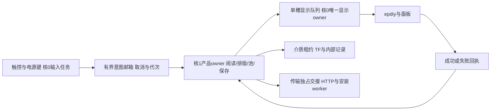

# PicoNano 当前架构与重点技术实现

更新：2026-10-14。本文描述当前工作区源码，已发布基线为 `0.6.3+a62e94a`，末节列出阅读优化及证据边界。旧设计与专题推导见[归档](archive/2026-10-14/README.md)，下一步方案见[开发指南](DEVELOPMENT_PLAN.md)。实现不等于真机验收。

## 实际模块与边界

设备装配和控制入口是 [main/app_main.c](../main/app_main.c)，仍有较多产品协调逻辑；不存在旧设计中的 `pn_shell`、`pn_power`、`pn_pdf`、`pn_update` 等独立产品组件。

| 当前目录 | 职责 | 主要入口 |
| --- | --- | --- |
| pn_core | 状态、取消、异步邮箱、池/缓存和 profile | [pn_async.h](../components/pn_core/include/pn_async.h)、[pn_alloc.h](../components/pn_core/include/pn_alloc.h) |
| pn_storage | 介质租约、完整身份、A/B 日志、位置/设置/书签 | [pn_media.c](../components/pn_storage/pn_media.c)、[pn_journal.c](../components/pn_storage/pn_journal.c) |
| pn_text | 编码解码、流式 TXT 与共用文本排版 | [pn_text_file.c](../components/pn_text/pn_text_file.c)、[pn_layout.c](../components/pn_text/pn_layout.c) |
| pn_format | ZIP、受限 XML/CSS/XHTML、出版物与目录 | [pn_zip.c](../components/pn_format/pn_zip.c)、[pn_xhtml.c](../components/pn_format/pn_xhtml.c) |
| pn_font / pn_image | 按需字体、回退链、PNG/JPEG 解码与缩放 | [pn_font.c](../components/pn_font/pn_font.c)、[pn_image.c](../components/pn_image/pn_image.c) |
| pn_reader | TXT/EPUB 会话、页节点、位置回执、菜单/设置/目录 | [pn_reader_app.c](../components/pn_reader/pn_reader_app.c)、[pn_epub_app.c](../components/pn_reader/pn_epub_app.c) |
| pn_library | 书库、封面、搜索、收藏操作及目录索引 | [pn_catalog.c](../components/pn_library/pn_catalog.c)、[pn_cover.c](../components/pn_library/pn_cover.c) |
| pn_transfer | 上传/接收、共享安装事务、worker、LocalSend 协议 | [pn_upload.c](../components/pn_transfer/pn_upload.c)、[pn_transfer_worker.c](../components/pn_transfer/pn_transfer_worker.c) |
| pn_ui / pn_widgets / pn_personalization | 灰阶绘制、命中、三键、设置/锁屏与字体管理 | [pn_style_ui.c](../components/pn_reader/pn_style_ui.c)、[pn_wallpaper.c](../components/pn_personalization/pn_wallpaper.c) |
| pn_display / main/device_* | 显示契约与设备硬件/网络/文件端口 | [device_async.c](../main/device_async.c)、[device_transfer.c](../main/device_transfer.c) |
| simulator / tests | PC 端口、可见 SDL、同源与故障验证 | [simulator](../simulator)、[tests/host](../tests/host)、[tests/installer](../tests/installer) |

核心、格式、字体、排版和 UI 共用 C 源。设备端口负责 TF/PMU/屏幕/网络等副作用；PC 只替换端口，不另造简化阅读器。render 仅绘制，不读写硬件或持久设置。

## 启动、任务与取消回执

启动检查 NVS、装配只读 VCOM 的 BSP、初始化摘要端口自检、非破坏挂载内部存储/TF、按实际可用 PSRAM 创建池、完成 PMU 运行握手，然后才开放产品显示。失败不会自动擦除或格式化；PMU/VCOM 门未通过不推屏。

[device_async.c](../main/device_async.c) 将输入和显示放在核 0，产品任务在核 1。触摸中、释放确认或读错时输入每 10ms 采样；完全空闲时输入任务等触摸 INT（GPIO43 任意边沿，[device_touch_wake.c](../main/device_touch_wake.c)），最多 50ms 兜底轮询，中断不可用时退回 10ms；电源键约每 100ms 查询。输入投递以任务通知唤醒产品 owner，产品在约 1 秒无输入/后台工作且无会话后最多 100ms 处理定时职责，否则仍 10ms；显示空闲期 100ms 检查断轨期限，电源轨保持期间持“禁止浅睡”锁（不锁频）。显示队列只有一个槽。输入线程不访问产品模型或池，显示 owner 不并发排版/分配。池及 FreeType/阅读模型仍由单个产品 owner 串行访问。产品提交显示后当前会等待回执，所以尚未实现“扫描期间产品并行准备下一页”。

有界邮箱区分当前 view/代次、导航与紧急意图；可替换尚未执行的导航，协作取消过期预排/打开任务，不无限积累翻页。请求、候选页和实际可见页分开：准备/绘制成功仍不能更新已显示位置，必须收到匹配会话/代次的成功显示回执。失败、过期回执和后台预排均不增加成功翻页数或保存位置。

开书 busy 页面提供返回/取消入口；小 TXT（不超过 64KiB）省去额外 loading 全刷。取消是协作式，已经开始的面板相位需安全完成；输入可采集不表示所有长调用已满足短时间片响应目标。

## 受控内存、缓存与身份

全部自有解析、字体、绘制和 UI 分配走 [pn_pool](../components/pn_core/pn_alloc.c)，含分配头计费，分类记录 used/peak/live、分配/失败和阶段同时峰值。池上限及池外账本见[硬件规格](HARDWARE.md)。FreeType、zlib、Expat、图片解码器通过外部 allocator 接入，不修改 vendor。

邻页、字形、非活动封面和章节语义共享 1MiB 可重建缓存额度，并受分项上限及前台余量约束。`pin/unpin` 保护借用中的指针；回收回调仅释放，不分配、不 I/O、不注销 owner。前台在安全边界回收并最多重试一次；可选预排/预热在 speculative 范围内，预算不足就退出，不驱逐其他缓存。当前可见页面、待提交位置和 A/B 保存资源不能作为普通缓存释放。

书籍身份是完整内容 SHA-256，路径只是实例。字体也用实际完整摘要参与布局键；不同文件即使同名/同大小/同 mtime，不能恢复旧进度。持久索引包含书/字体/样式/引擎版本，损坏或失配按缓存缺失处理，不能代替真实内容识别。

[device_identity.c](../main/device_identity.c) 用 SDK 管理 SHA 外设锁并先做自检；非 DMA 输入在内部 DMA 最大连续块不少于 96KiB 时临时借 32KiB 块读完即还（保留 64KiB 内部余量），否则转内部对齐 4KiB 栈工作区，真实文件读取和完整身份语义仍在共享层。主机使用完整软件 SHA，有界读取工作区可退到 4KiB。优化不得按 size/mtime 跳过整书校验；同一已验证句柄只有介质租约与来源仍有效时可复用。

## TXT 打开、分页和恢复

[pn_text_file.c](../components/pn_text/pn_text_file.c) 支持 UTF-8/BOM、UTF-16 与 GBK，解码位置保留原字节偏移、编码及段落策略。流式 source 使用实际文件游标避免无用 seek；解码检查点、当前位置及邻页节点有界，不把整书加载成 RAM 字符串。

[pn_reader.c](../components/pn_reader/pn_reader.c) 基于共用排版器建立当前页及前后邻页，有界历史辅助反向翻页。预排页尚未显示，不能修改进度。字号/字体/字距等重排从原源锚点恢复，取消设置回旧排版与原锚点，不能把永久位置保存成派生页码。

[pn_page_index.c](../components/pn_reader/pn_page_index.c) 保存最多 512 个页边界，内部缓存目录全局 128KiB。打开先核对书籍、字体及布局键；附近边界帮助冷反向补排，缺失则回到源解析。这是局部窗口，尚未交付全书多段稀疏索引或所有大书 O(1) 跳转。

## EPUB 容器、语义模型与大型书

容器入口 [pn_zip.c](../components/pn_format/pn_zip.c) 验证 EOCD/中央目录、路径、局部头、压缩类型、额外字段、描述符与资源 CRC，拒绝重叠/越界等异常。中央目录临时分段读取受 128KiB 限制，用完释放。EPUB 打开先校验中央目录，再在整书 SHA 的顺序读取中顺带截取并校验各条目本地头/描述符（`pn_zip_scan_*`），只有未截取到的条目（如超大扩展区）在结束时随机读取，重叠/重名检查不变，因此不再逐条随机读卡；出版物长生命周期保留 ZIP source，不复制整本 EPUB。

[pn_epub.c](../components/pn_format/pn_epub.c) 解析 container/OPF、manifest/spine 和 EPUB2/3 导航。manifest ID/path 用紧凑可变长度存储，ID 排序后二分查找，spine 关联 ZIP 索引；当前查找不是旧猜测中的全表平方扫描。目录、作者/标题和图片源由出版物结构给出，受限重排能力不等于完整 EPUB/CSS/固定布局兼容。

XHTML 不建立通用 DOM：先完整验证章节 XML/CRC 并处理 head 中本地 CSS，再发出正文事件；无网络资源、脚本或书内字体安装。样式按受限声明/选择器解析，超范围有明确限制。章节字节缓存受 128KiB 上限；可重建语义模型单章最多 384KiB，与其他缓存共享原 1MiB 总额；文本按最大码点存 1/2/4 字节，位置连续时省略差值表。超出上限的章在页面请求提供起点时只保留起点附近的已验证窗口（起点前约 1/4、到达后约 1/8 上限，其余向后），记录丢弃事件数、最大元素号和最后流事件，复放前由页面消费者接续序号与段落状态；起点不在窗口内或尾部不够时回到章首完整冷解析并重建。完整扫描接口（锚点/顺序/检查点）不使用窗口。预排中失败不记成永久跳过。准入失败仍保留流式解析退路，不能因缓存失败拒绝本来可流式阅读的书。

语义事件描述文字、块边界、图片、样式及 locator。永久定位保留 spine、元素/run/offset/kind 与解析版本，派生事件顺序仅用于缓存。普通页、跳转、目录/书签恢复、anchor 定位的完整性要求不同，不能用“页已满”截断所有解析接口。

[pn_epub_reader.c](../components/pn_reader/pn_epub_reader.c) 与 [pn_epub_page.c](../components/pn_reader/pn_epub_page.c) 缓存页节点、前后邻页及页边界；图片前释放不必要邻页并暂停字体以留出峰值。图片使用 PNG/JPEG 有界扫描线/降采样处理，部分超限/不支持情况可占位；I/O、介质失效和取消不能冒充图片格式失败。大型渐进 JPEG 的系数内存仍可能超预算，不能宣称所有插图均可显示。

冷开仍须完整 SHA、出版物构造、首次章节验证和字体光栅。大文件、长章节、大图是不同压力维度，不能用“很多小章节”的 EPUB 证明超长章节/巨图性能。最新热页优化见本文末节，进一步方案见开发指南 R03/R04。

## 字体、灰阶与阅读线

[pn_font.c](../components/pn_font/pn_font.c) 使用固定 FreeType 2.14.3 子集构建，完整 TTF 按需读，度量与字形缓存纳入池；默认正文黑体、外置主字体/备用字体及常驻中文 fallback 分层。界面中文不依赖用户正文字体，删除/缺卡/源失效时保持 UI 可用并提示正文回退。

字形缓存按字体上下文隔离，键包含实际字号、码点及横向 26.6 分数位置，覆盖率位图共用于灰阶/二值混合。度量、断行与光栅共用真实字体数据；字距改变位置而非拉伸字形。像素混合保留原灰阶舍入和二值阈值，不能借提速损失阅读像素。上传字体限 32MiB，通过完整摘要、元数据和字形检查后进入共享安装事务；上传成功不自动替换正在用的字体。

排版草稿包括字号 28–72px、行距 100–220%、段距 0–100%、缩进 0–2 字、字距 0–50%、左右边距 16–80 偶数px，以及阅读线和位置。设备默认 44px/145%/25%/不缩进/32px/字距0。原产品计划的预设、字重、对齐、TXT 段落模式、全局继承等仍有未完项，不能当这些字段均已交付。

阅读线为关闭/虚线/点线，默认关闭；深浅分浅/中/深/黑（灰阶 10/7/4/0，新书默认中，旧记录为浅）；1px 线跟随真实文字行，偏移 -8…8px、步进2，限制在正文，不侵入页脚。TXT/EPUB 共用草稿、预览、应用和取消。`PNTS` schema4 为 64 字节：0…7 头部，8…39 内容 SHA，40…51 原六字段，52…53 字距，54…55 阅读线，56…57 有符号偏移，58…59 阅读线深浅，60…63 保留0；schema3 读为浅，旧 schema1/2 默认关闭阅读线。旧 `gl_before_clear` 字段只做二进制兼容，不控制现行刷新周期。

应用先验证/重排/成功呈现，再保存并确认读回；写入报错可能已提交，必须重读核对候选。未确认应用保留会话供重试；未应用草稿在离书/锁屏时丢弃。预览已经显示而保存失败时应明确说明，不能伪称屏幕仍是旧排版。

## 显示、翻页与残影控制

唯一显示 owner 调用 [app_main.c 的面板适配](../main/app_main.c)，逻辑阅读用途与管理用途分开。当前正文走原生灰阶 GL16 全像素路径，不开放未经验证的 DU 二值快刷。逻辑阅读成功前后翻页按全局档位 6/14/24 页触发 GC16，预览、失败、重画和后台页不计；管理页独立累计 24 次成功更新。物理整刷成功回执重置相应维护状态。

已知参考帧的周期 GC16 直接全屏转换，省去额外白场；手动深清、未知参考和欠载恢复才执行白场重建。软件脏区只指导管理页局部 GL16，不代表物理残影程度。普通阅读沿 [pn_reader_chrome.h](../components/pn_reader/include/pn_reader_chrome.h) 的 y=1152 对齐分带：正文全像素清理覆盖末行，64px 页脚仅更新差异，避免反复驱动整条灰色进度轨；上层仍是一张页的单次呈现请求，底层可以分带扫描。

设备先把目标帧转换进 epdiy 前缓冲，再与后缓冲（epdiy 每次绘制后回写，等于已显示内容）按板级方向比较得到逻辑外接框；书库操作面板的底图也由后缓冲逆变换得到，池内不再保留 406KiB 已显示副本。失败失去已知参考，下一次从白场重建；供数不足退安全 pclk 并从白场恢复目标帧。成功后的电源轨保持 8 秒空闲窗口，失败立即释放。波形、VCOM 和 PMU 厂级时序保持原样，当前传入温度值与真实温度校准仍须设备核对。

旧两帧翻页动画已移除，翻页不再额外占 831744 字节。工具栏只快照覆盖区域，恢复依赖成功正文；失败不破坏其底图。透明壁纸遮罩只在锁屏专用 canvas 解码/合成，不绑定阅读 body_layer，解锁恢复成功正文。这修复了未锁屏也覆盖正文的问题，光学验收仍需设备。

`Present` 记录 reading/management/requested/maintenance/manual/unknown-reference/underrun 原因；`Display stages` 拆 dirty/convert/power/scan/remember，另有 queue/wait/receipt。等待包含实际面板扫描，不能当纯 CPU 准备时间，子阶段不重复相加。

## 阅读记录、书签与保存屏障

[pn_journal.c](../components/pn_storage/pn_journal.c) 使用 PNJR 双槽、序号、CRC、同步及读回确认；进度/书签/设置存放内部 `/data/progress` 系列文件，**不是产品 NVS 设置**。只有确认成功显示的位置进入保存策略：累计 5 次有效翻页，或首次未保存变化满 30 秒触发，连翻不推迟起点。离书、锁屏、传输交接必须强制保存确认，失败不释放关键句柄、不切电。

TXT 保存原字节/编码/段落信息，EPUB 保存语义 locator。每书最多 100 个书签，最近记录最多 20 条；同内容位置防重复，清历史/清进度/删除书签/删原书是不同操作。来源丢失仍保留记录，同名新内容不能误恢复。异常掉电只保证最后有效提交，不承诺文件系统已经损坏时仍满足 5页/30秒窗口。

[pn_media.c](../components/pn_storage/pn_media.c) 用介质 epoch 和读/写/独占租约防止旧句柄读新卡；换卡/退出外部访问必须重新检查。持久分页窗口和书库索引可删重建，缓存失败不破坏独立位置/书签。

## 无线传书、安装事务与退出

AP 和 STA 共用网页与共享安装层。AP 每次生成随机 12 字符 WPA2 口令，两码分别连接热点/打开网页；STA 保存单个家庭网络到内部 PNWC A/B 记录，密码不回显/不记日志、退出清 RAM。Flash 加密未开启时这不等同加密凭据存储；网络扫描、多网络及设备键盘配网未完成。

手工 6 位配对码已移除。网页 GET 自动取得当前会话的随机 128 位 RAM token，仍校验窄化 IPv4 Host/Origin、重复头和请求边界，使用本地静态资源/CSP；普通 LAN HTTP 不具有 TLS 保密。移除手工输入不等于删除会话隔离、所有权与跨源检查。

[device_transfer.c](../main/device_transfer.c) 进入传输先保存并关闭书籍/字体/预排，再将 TF 交给传输 owner。HTTP 服务与安装 worker 共享固定目录与事务，客户端不能选择路径；完整分类见 [SD_CARD_LAYOUT](SD_CARD_LAYOUT.md)。网页分块最多 64KiB、ACK 代表已同步的持久偏移；最终摘要/格式检查与可恢复备份替换提交后才显示“已保存”。队列逐文件反馈，网络断开不自动取消成功项。

STA 会话有界连接/重连（20秒内至多3次），活动时设 PS_NONE；同 IP 重连保留会话，新 IP 或最终失败关闭。`/api/v1/status` 提供当前连接的有效负值 RSSI、断连/恢复计数和 SDK 原因，最多每秒采样，不包含凭据。设备数据接口恢复与 TF 所有权恢复都依赖完整停止屏障。

停止流程是：请求停止并作废网页 token → 停止 HTTP/等待请求 → join worker/完成或保留安装恢复记录 → 释放传输资源与卡租约 → 清理 WiFi、恢复 USB → 归还产品、按原锚点恢复。失败保留句柄重试，不能只把界面改成“关闭”就提前回收。无操作锁屏仅在 `!transfer.impl && !time_sync.impl` 时触发，**活动 WiFi 传书期间没有五分钟自动待机**；手机自身休眠/断网是另一个因素。

[device_card_presence.c](../main/device_card_presence.c) 从 P0.6 检测适配读取卡状态，将 I2C 读取失败与真实拔卡分开，临时 I/O 不永久当成媒体失效；写入门暂停并有界等待。用户“存储介质已失效”反馈与这条路径相关，但必须设备日志验证，不能仅凭提示证明 RF 或卡物理故障。

[device_usb_radio.c](../main/device_usb_radio.c) 在 WiFi 前暂停 USB 数据 PHY，清理回调/驱动结束后恢复先前状态，充电不受该操作关闭。它是针对 SDK USB/RF 影响的候选规避；插电脑与充电器均触发故障说明仍需排查供电/射频/检测路径，不能归结成电脑串口独占。

LocalSend 同源 JSON/授权/确认/整文件接收、PC HTTP/IPv4 发现以及设备发现/HTTP 适配已有源码。整文件中断重发不等同网页分块续传；官方客户端 HTTPS、设备发现、中文确认/取消和停止屏障完整互通尚未验收。Windows UDP 53317 保留属于主机发现环境问题，不能用它解释路由器 STA 网页上传失败。

## 首页、锁屏与电源

首页、书库、传书、设置四栏分工；最近阅读使用真实记录，书库支持三列/四列/列表、名称搜索、拼音首字母跳转、收藏和独立删除确认。元数据/文字先出屏，封面按可见优先空闲处理，页完成后合并重画，坏图回占位不跳过书籍。目录索引按 64 条排序批次写磁盘；全书增量更新、作者/时间排序、集合/批量管理仍有缺口。

锁屏原图在 TF，预处理后的 4bpp 位图及元数据在内部独立 1MiB 分区 A/B 存储，保留有效旧槽。上传图片不自动应用；contain/cover/旋转/预览/应用与取消共用事务，书封模式失败回默认。缺卡可使用内部有效缓存，解锁恢复原书。透明遮罩模式首次锁屏解码原图后，把灰度/透明两平面写入 TF 私有 `.readpico/masks`（原图路径/大小/mtime/变换/算法版本为键、CRC 校验、临时文件同步后替换），以后锁屏只读两平面并按字节合成；缓存损坏或键变化回到完整解码，写失败不影响锁屏。

电源短按和五分钟无输入经过保存屏障、锁页呈现、关轨后进入浅睡，唤醒重核介质并恢复正文；传输和对时使用自己的停止门。开启 `CONFIG_PM_ENABLE` 动态调频：产品 owner 收到输入或做后台封面/预排/索引工作时持最高频锁，连续空闲约 1 秒放锁降到 80MHz（仍为 PLL，不切 MSPI 低速），显示任务扫描期间、无线传书/对时会话期间始终持锁。开启 tickless 自动浅睡：无任何锁时空闲任务进入浅睡；工作/扫描锁、电源轨保持期的禁止浅睡锁、无线会话以及 SDMMC/I²C 驱动事务锁都会阻止浅睡；浅睡中 GPIO 边沿不能唤醒，空闲触摸改为 30ms 定时采样（醒着时 INT 边沿仍立即唤醒）；插电脑 USB 时保持唤醒以便日志与网页刷写。浅睡期间 IDF 按 ESD 勘误隔离全部 GPIO，板级初始化后给 SD CMD/D0、I²C、触摸/扩展器中断设睡眠上拉、蜂鸣器下拉。注意 0.6.1/0.6.2 发布固件因漏含 `sdkconfig.h` 调频/浅睡未生效。PMU 软睡/关机、自动时长配置、拿起唤醒和续航验收仍未完成，不能把当前 shallow sleep 宣称为全部电源能力。

## 三键与步进输入

管理页 KEY1 左返回、KEY2 中首页、KEY3 右确认；书库 KEY2 先聚焦首项，再按打开，阅读 KEY2 短按工具栏、长按返回书库，KEY1/3 翻页；正文触摸点按只分左半/右半翻页，点中间不再打开工具栏，横滑翻页不变。设置页不再有局域网传书入口，传书统一从底栏进入。设置步进键长按满600ms后每180ms走一档，松手不补一步；不同页面的焦点/命中由同源 UI 处理。触摸阈值、左右手与开关可配置，但真机坐标与实际反馈时间仍需校准。

## 日期时间同步

[device_time.c](../main/device_time.c) 在“设置 → 存储与关于 → 日期与时间”手动启动单 owner 任务，仅借用已保存 STA，不拿 TF、不自动开机联网、不与传输并行。首次 poll 才开始联网以先显示进度；连接 20秒/至多3次，SNTP 指向 `pool.ntp.org`，每100ms零等待查询，12秒截止。UTC 接受范围为 2024–2099 年。

成功取得时间后先停止 SNTP/WiFi、恢复 USB，清理失败保留句柄；按单调计时补偿清理耗时，再由 [device_time_pmu.c](../main/device_time_pmu.c) 发 `TIME_SYNC` 四字节小端 UTC，随后 `TIME_GET` 验证有效/已同步标记及 0…10秒差。只有 PMU 确认才更新产品日期、HH:MM 状态时钟，失败保留旧显示。

页面返回可让有界任务继续，结束/电源键先取消并等待清理，再锁屏。任务期间禁止自动待机和第二个传输。启动从有效 PMU 时基加 uptime，显示 UTC+8；不猜编译时间，PMU 复位后仍可能需重新对时。手机传入时间、时区设置、自动校时还只是后续方案。

## 安装、升级及复用来源

当前网页是电脑 Chrome/Edge Web Serial 安装器，由 `installer/`、固定 esptool-js0.5.7、发布清单与 Pages 工作流组成。默认升级核对已知旧设备 3072 字节分区表，只写 `0x20000` 应用；RTC 强制下载位/原生 USB watchdog 复位放在自有适配，不改 vendor。它不是设备无线 OTA，也没有已交付的原子切槽/签名/失败回滚，详细规则见[安装文档](INSTALLATION.md)。

复用来源由 [LICENSES](../LICENSES) 的 reference/FreeType/LittleFS/zlib/Expat/spng/jpeg/cJSON/QR/esptool/font 清单固定。自身代码 Apache-2.0；epdiy fork LGPL-3.0-or-later，发行材料须遵从其实际条款。字体 OFL 与 HarmonyOS 原许可独立保留；不改许可身份或生成表。PDF 引擎尚未选定并通过许可/预算技术门。

## 性能利用与阅读优化

CPU 频率、板级 MSPI、高速 SDMMC、双核分工、GDMA/SHA 已配置，仍有字形命中、重复章遍历、完整扫描与显示等待的优化空间。没有最新同书真机 CPU/总线/堆/功耗对照，不能给出“硬件利用率百分比”。既有设备线索：完整 SHA 约5.016秒、正文光栅约383ms、扫描约471ms；后续 DMA/SHA 修正与本节优化尚需对应固件复测。

`0.6` 包含的实现（软件验证与固件构建完成，真机未测）：

1. `pn_font_warm` 按实际码点/26.6 横坐标预热同一字形缓存；TXT/EPUB 遍历已预排邻页，每次最多8项，换邻页/布局重置游标，含图片页跳过，预算不足不抢占。预热不修改像素、显示回执或进度。
2. 原 BMP 512 槽改为四路组相联及局部 LRU，避免高碰撞直接覆盖；保留原表容量与字形预算，老化回绕有界处理。
3. 章节模型改紧凑短段存储，64 scalar 临时 builder 在堆中，额外约448字节；按实际码点分配而非每短段固定64槽，每标量按最大码点存 1/2/4 字节并在位置连续时省略 u16 差值（中文约 6→2 字节/标量）。384KiB 上限和流式退路保持。
5. 超上限长章保留起点附近的已验证语义窗口，见上文 EPUB 节；原创约 30 万中文标量单章 120 次下一页+40 次上一页，XML 解析 976→16 次，主机 ASan 18.4s→1.6s，三种上限（0/48KiB/384KiB）逐帧一致；峰值因可回收窗口增加约 350KiB。
6. 设备整书 SHA 由 4KiB 栈块改为可用时借用 32KiB 内部 DMA 块，主机替身验证读取次数 17→3 与摘要一致；TF 实际吞吐未测。
4. `pn_xhtml_parse_window` 只对完整验证后的语义模型复放热页，在页完整且必要 stop anchor 到达后停止；普通 parse/anchor/order 接口仍执行完整语义，首次 CRC/XML/CSS 不跳过。

软件证据：受控新字形下一页案例 FT render 调用 TXT 122→46、EPUB 128→50，完整415872字节结果一致，准备过程不移动已显示/保存位置。相同原创 9,940,603 字节、400章 EPUB 各30轮、6MiB池、ASan/UBSan、新状态、完整 SHA 对照如下；OS 文件缓存未受控，没有大图片，不是实机 TF/面板结果。

| 阶段 | 基线 p50/p95 | 当前 p50/p95 | 解读 |
| --- | --- | --- | --- |
| 下一页准备 | 3.915 / 4.460ms | 0.197 / 0.344ms | 已验证模型热复放收益 |
| 完整 SHA | 316.701 / 328.177ms | 318.010 / 328.756ms | 无改善证据 |
| 打开（不含首帧） | 436.592 / 470.843ms | 437.132 / 455.503ms | 冷开主项仍在 |
| 正文混合绘制 | 3.436 / 6.850ms | 3.512 / 6.781ms | 无整体光栅改善证据 |
| 会话池峰值 | 1242922 字节 | 1406870 字节 | 保留模型增加约160KiB，可回收成本 |

本阶段完整143项 CTest、10项 Python、5项 Node 和31项 SDL 已通过；末尾最小预热准入守卫后再跑5项相关回归。没有重新做两套固件构建/烧录，不把已发布版本继承为这些改动的构建证据。原始日志留 `build-dev/reading-next/`，旧专项分析及六个参考项目的固定提交/取舍保留在[阅读响应归档](archive/2026-10-14/READING_RESPONSE_PLAN.md)。
