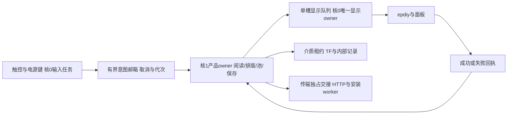

# PicoNano 当前架构与重点技术实现

更新：2026-10-18。本文描述0.9.13测试预览源码（构建来源见发布清单），末节列出阅读优化及证据边界。旧设计与专题推导见[归档](archive/2026-10-14/README.md)，下一步方案见[开发指南](DEVELOPMENT_PLAN.md)。实现不等于真机验收。

共享可重建缓存总额按应用池大小分三档：池≥6MiB 为 2MiB，4–6MiB 为 1.5MiB，小池为 1MiB（[pn_alloc.c](../components/pn_core/pn_alloc.c)）。下文历史优化段落中的“1.5MiB/1MiB”是当时档位，当前 6MiB 池以 2MiB 为准。

## 实际模块与边界

开发树的菜单字体缓存采用八路组相联：字宽表仍为1024项，组内按最近使用前移，不加时间戳或扩大表；字形位图仍为1024槽、704KiB上限，只将四路改成八路。它减少多个字号在少数槽内互相覆盖、反复加载同一轮廓和TF字体块的情况。命中仍检查取消和源有效性，缺字、回收、低预算直接绘制与强身份校验保持。实际产品菜单探针使用用户书籍副本及四款用户字体分别作固定TF界面源，首页/设置/传书/书库往返第四轮的字体文件读取由每页40～180KiB降为0，68张完整菜单帧与旧缓存实现一致；这是主机文件端口证据，固定鸿蒙资源、实卡与面板响应另验。

0.6.15增加首页/书库封面槽重绑：返回菜单不再无条件清空全部已验证像素并重读PNCV，而是先复核介质对象、epoch/实例号、原书和旁图的既有来源键，再在原13个槽内交换或复制。重排连同元数据、失败原因、来源键及待写资格一起移动；重复书优先保留待写源并只由一个活动槽写缓存；离页的待写资格暂存，重新进入才续写，空闲槽可暂留离页像素。取消预检、USB栅栏或介质不可用时不改原槽；换卡强制重新走磁盘校验，IO/取消/内存不足不成为可重复使用的稳定结果。缓存缺失仍按原后台提取/写入，PNCVv6与184×256/4bpp保持；这是可重建封面来源键，不能代替阅读开书的完整SHA身份。封面路径用完整路径字符串的SHA匹配，磁盘包仍保存完整路径；64位主机对象322480B，比原对象仅增加504B，仍在原384KiB封面分项与6MiB池内，无第二套缩略图。冷绑定复用同一READ租约下已取得的来源键，不重复stat。来源stat与菜单绘制/显示仍有成本；文件端口减少和主机逐帧一致不能当作TF或面板实测。

0.6.14在自有设备输入端将CST836U记录归一为活动触点，UP占槽不再视为按住；混合UP/活动点时选实际活动点，空报告不采用未报告槽的旧UP，坏记录进入既有取消路径。明确UP的有效终点随邮箱传到产品，书架在首次空样本前补最后坐标，再沿两次空采样确认释放；普通空报告不伪造坐标。同步降级轮询与异步输入使用同一归一函数。横滑仍须至少100px且横向距离大于纵向两倍；较早出现明显垂直意图仍取消，不再因横向主导手势的纵移超过固定80px一律拒绝。首页不横滑、多点/读错/模态/边缘不越页、长按一次等规则保持。四列第11/12项与旧书签快捷码10/11的冲突通过限制旧路由到阅读正文解决。SDK替身与用户整库的真实产品路由、SDL分别验证，实际触摸控制器轨迹与面板响应待刷机复验。

0.6.11固定底栏输入：首页/书库/传书/设置一级页在首次有效单点按下时沿原命中/选择路由发起切页，不等松手，也不额外扫描短反馈。共享`pn_tap_press`只占定长状态，无堆/帧；切页不能重置接触所有权，持续持有、移动、多点、读错和松手不再操作新页，两个有效空样本才重新允许下一接触。内容滑入底栏只取消、不补选；子页、模态、阅读控件及活动传输仍沿原确认规则。过期普通事件不能用旧坐标选择新页，但设备的有效空样本仍可解除所有权；SDL保留被页面代次丢弃的真实左键松手证明，避免扫描中松手后吞下一点击。SDL把已确认导航交给原选择分支，真实松手由共享状态消费；默认反馈资格仍关闭，波形、区域维护、页数、正文位置提交与6MiB预算保持。首次动作更早不等于面板扫描更短，实机首显与稳定时延另验。

开发树补充“连续固定底栏”输入上下文：产品owner在同一邮箱锁内发布view和真实一级页资格，输入owner只为有效单点固定底栏事件请求盖章，同锁复核捕获view一致；消费时再核对连续上下文、触点种类与固定几何。四个一级页之间的成功扫描换代不再丢弃已排队的下一次底栏点击，持续接触仍交给原`pn_tap_press`，不因收到一条移动而重新导航。进入非一级页呈现前立即撤销资格，覆盖两次主循环之间的临时子页/模态；开书门和输入暂停同样撤销，返回一级页重新启用也不能复活旧印记，计数耗尽时拒绝跨帧保留。普通投递不能伪造印记，内容区/子页/失效捕获仍走原代次取消；不靠页面ID猜测设置子页是否有底栏。真实SDK对象中静态`async_port`由2144B增为2352B（+208B），非实际堆栈水位。

已确认一级页导航后，前台owner在同锁下取出当前最多24条普通边沿的有界快照，仍按原接触顺序消费真实释放、无效/多点及失焦，只合并具有当前连续印记的独立底栏目标，最后绘制一次选中目标。快照中的旧内容/普通按键命令不执行；优先导航槽保持独立，存在优先项即不取批次，先交回原路由，溢出仍取消。成功只接纳已经取出的批次取消代次，锁外后来新输入仍能取消准备，不能反复清空或重置整个邮箱。快照函数独立栈帧，返回后才绘制，无新增堆、帧或队列字段；本阶段静态端口仍2352B。批次已消费最终释放时同步触点持有状态，避免等待不存在的下一条UP而阻止空闲索引/封面；真正未释放时仍阻止空闲工作。只改变已积压导航的目标准备次数，不截断已开始扫描，不改变单次波形时间。

SDL失焦事件在窗口owner捕获时保存左键状态，消费时不能借用后来UP更新的全局鼠标状态；真实过期UP仍提供原释放证明，溢出及缺少释放证明的合成事件先阻止同一持有重新导航。该规则与真实设备有效空触点的所有权保持一致；窗口失焦检查不是板级触控验收。

设备装配和控制入口是 [main/app_main.c](../main/app_main.c)，仍有较多产品协调逻辑；不存在旧设计中的 `pn_shell`、`pn_power`、`pn_pdf`、`pn_update` 等独立产品组件。

| 当前目录 | 职责 | 主要入口 |
| --- | --- | --- |
| pn_core | 状态、取消、异步邮箱、池/缓存和 profile | [pn_async.h](../components/pn_core/include/pn_async.h)、[pn_alloc.h](../components/pn_core/include/pn_alloc.h) |
| pn_storage | 介质租约、完整身份、A/B 日志、位置/设置/书签 | [pn_media.c](../components/pn_storage/pn_media.c)、[pn_journal.c](../components/pn_storage/pn_journal.c) |
| pn_text | 编码解码、流式 TXT 与共用文本排版 | [pn_text_file.c](../components/pn_text/pn_text_file.c)、[pn_layout.c](../components/pn_text/pn_layout.c) |
| pn_format | ZIP、受限 XML/CSS/XHTML、出版物与目录 | [pn_zip.c](../components/pn_format/pn_zip.c)、[pn_xhtml.c](../components/pn_format/pn_xhtml.c) |
| pn_font / pn_image | 按需字体、回退链、PNG/JPEG 解码与缩放 | [pn_font.c](../components/pn_font/pn_font.c)、[pn_image.c](../components/pn_image/pn_image.c) |
| pn_reader | TXT/EPUB 会话、页节点、位置回执、菜单/设置/目录 | [pn_reader_app.c](../components/pn_reader/pn_reader_app.c)、[pn_epub_app.c](../components/pn_reader/pn_epub_app.c) |
| pn_library | 书库、封面、搜索、收藏操作及目录索引 | [pn_catalog.c](../components/pn_library/pn_catalog.c)、[pn_cover.c](../components/pn_library/pn_cover.c) |
| pn_transfer | 上传/接收、共享安装事务、worker、LocalSend 协议 | [pn_upload.c](../components/pn_transfer/pn_upload.c)、[pn_transfer_worker.c](../components/pn_transfer/pn_transfer_worker.c) |
| pn_update | 签名清单、真实应用头校验、非活动槽写入与显式启动提交 | [pn_update.h](../components/pn_update/include/pn_update.h)、[pn_update.c](../components/pn_update/pn_update.c) |
| pn_ui / pn_widgets / pn_personalization | 灰阶绘制、命中、三键、设置/锁屏与字体管理 | [pn_style_ui.c](../components/pn_reader/pn_style_ui.c)、[pn_wallpaper.c](../components/pn_personalization/pn_wallpaper.c) |
| pn_display / main/device_* | 显示契约与设备硬件/网络/文件端口 | [device_async.c](../main/device_async.c)、[device_transfer.c](../main/device_transfer.c) |
| simulator / tests | PC 端口、可见 SDL、同源与故障验证 | [simulator](../simulator)、[tests/host](../tests/host)、[tests/installer](../tests/installer) |

核心、格式、字体、排版和 UI 共用 C 源。设备端口负责 TF/PMU/屏幕/网络等副作用；PC 只替换端口，不另造简化阅读器。render 仅绘制，不读写硬件或持久设置。

0.6.10菜单图元优化：4bpp矩形在裁剪后按整字节填充，奇数边界保留邻像素与行尾；圆角填充只对确定全覆盖的内区使用跨度，描边跳过确定透明的深处。所有可见圆角边缘沿用原距离、混合和灰阶公式；极端坐标先以64位裁剪，保留原距离计算，未加帧/字形缓存或改波形。设置页已移除网络名行，兼容SSID快照更新不再重复重画相同整帧。不能将图元优化当全部切换时延已解决。

0.6.10设置字体复用：设备和SDL在池至少4MiB时，设置页从同一管理字体空槽移交引擎，关闭后归还，书库/首页/设置之间保持原引擎地址及可回收字形。`pn_font_move`只转移同池唯一所有权，不分配、不访问源；接管前另检查取消和源有效性，字号与墨色随对象返回。绘制失败仍由原设置对象重试，分配/取消/错池失败保留原槽；归还槽须存活且期间不被使用，异常被填满时关闭自己的引擎而不覆盖另一所有者。原API及不足4MiB路径仍按原方式打开/关闭，缓存预算不增加。关闭系统字库、换卡、字体管理及USB/传输交接前先关闭设置，再释放归还槽和原源；没有复制活动引擎、也不借此跳过内容身份。像素与原冷打开一致不等于实机响应验收。

0.6.10设备风险统计优化：对齐的板级前后帧按32位字并行分类八个4bpp像素，用每半字节一位的掩码累计原灰色/深色/转白计数；白和浅灰旧像素跳过，仅有转白资格时读取目标。通过`memcpy`保留别名规则，未对齐的源仍用原两像素判据。每行后只在原清屏条件已经满足时提前结束，计数单调增加保证结论不变；正文范围、阈值、区域维护、固定页数与成功提交规则均保持。无新查表、帧或堆分配，只有局部整数和常量；主机算法计时与S3函数交叉编译不代表面板提速已验收。

## 0.6.12 TXT、书架与传输启动

TXT打开由`pn_text_file_inspect`借完整SHA的只读块同时做严格UTF8/BOM-UTF16探测，跨块仅保留8字节前瞻和原256字节解码缓存；完整原文件摘要、512个原字节检查点与取消仍保留，不按mtime猜书籍身份。UTF解码正常只读一遍原书；无BOM且UTF8损坏时仍完整重试原GBK判据，所有验证成功后才发布身份/编码。探测每256字节检查取消，普通`pn_text_next`的每字符源验证保持。空文件、短读、代理对、CRLF与失败输出沿原契约。

开发树另减少UTF8缓存内的重复寻址：完整标量已处于原256字节缓存时，续字节直接索引同一块；跨块仍沿原逐字节读取/错误路径。最短编码、代理区/Unicode上界、每次next的取消/源检查和原字节范围保持，不加缓冲或绕过摘要。用户三本TXT的七轮交替`-O2`主机对照中，完整摘要+探测步骤的CPU中位数下降约16%；14.7MB刀剑TXT从约78ms到65ms，仍读取14686701B/449次，完整SHA和510检查点一致。这个数值不是设备开书总时延；完整身份、面板及其余准备仍有成本。

TXT排版保留全部字符/原字节范围，把重复或仅空白的行作为同一段落边界，避免原文空行与用户段距重复累加。紧凑空白策略只用于TXT，其分页键增加独立策略号，原EPUB分页/语义缓存不失效；旧进度仍用源偏移重排。全空白长输入按节点容量安全推进，不无限增长。成功热挂起也使首页最近阅读快照失效，下次回首页重新读取已保存记录，失败保存不能冒充已更新。

网格三列每页9本、四列每页12本，列表仍5本；搜索入口、封面省略号和分页按钮移除，页码只读，内容区左右滑动翻页。书籍短按打开，600ms长按菜单；移动20px后取消打开/长按，水平位移至少100px、竖向不超过80px且水平大于竖向两倍才在两次有效释放后翻页。多点/读错/子页取消；持有、页面改变及边界滑动不补开书，固定底栏仍由独立按下所有权接管。书籍0..11与导航/继续阅读编号隔离。封面保留184×256缓存，绘制尺寸适配三行，网格不再另列作者；详情保留元数据。缩放横向边界复用、直接成对写4bpp，原盒滤波和取整保持；封面资源流绑定ZIP后提前归还已复制完元信息的OPF模型及元信息读取块，给大JPEG系数留出峰值；封面分项准入384KiB容纳13槽，总1.5MiB/1MiB缓存及6MiB池不变。

传输文件worker用ESP-IDF的WithCaps配对API将原32KiB栈放在PSRAM，监督内部栈保持16KiB，为WiFi/TCP留出32KiB内部RAM申请空间，未减少校验栈容量。HTTP保持内部16KiB栈；栈与固定请求槽不混入6MiB事务池峰值。内部DMA工作区也检查PSRAM栈并借用4KiB内部块，申请失败明确返回。WiFi失败清理后仍保留本次SDK错误，UI快照区分存储/文件任务/无线启动/网络连接/接收服务，AP/STA身份从启动即保留。UDP发现失败保留已启动HTTP及安装事务，每2秒可重试；仅实际发现成功才显示LocalSend可发现。软件故障注入与SDK构建不能证明用户设备已恢复联网，需刷机复验。

## 启动、任务与取消回执

启动检查 NVS、装配只读 VCOM 的 BSP、初始化摘要端口自检、非破坏挂载内部存储/TF、按实际可用 PSRAM 创建池、完成 PMU 运行握手，然后才开放产品显示。失败不会自动擦除或格式化；PMU/VCOM 门未通过不推屏。

[device_async.c](../main/device_async.c) 将输入和显示放在核 0，产品任务在核 1。触摸中、释放确认或读错时输入每 10ms 采样；完全空闲时输入任务等触摸 INT（GPIO43 任意边沿，[device_touch_wake.c](../main/device_touch_wake.c)），最多 50ms 兜底轮询，中断不可用时退回 10ms；电源键约每 100ms 查询。输入投递以任务通知唤醒产品 owner，产品在约 1 秒无输入/后台工作且无会话后最多 100ms 处理定时职责，否则仍 10ms；显示空闲期 100ms 检查断轨期限，电源轨保持期间持“禁止浅睡”锁（不锁频）。显示队列只有一个槽。输入线程不访问产品模型或池，显示 owner 不并发排版/分配。池及 FreeType/阅读模型仍由单个产品 owner 串行访问。产品提交显示后等待回执；阅读翻页时等待期间以有界小步调用重叠钩子（[device_async.c](../main/device_async.c) `overlap`）：以待确认页为基准排下一页并预热其字形，不触碰被扫描帧、不改已显示/保存状态，呈现失败时推测邻页因锚点不匹配而不被使用；一旦出现供数欠载即本会话停用重叠。

有界邮箱区分当前 view/代次、导航与紧急意图；可替换尚未执行的导航，协作取消过期预排/打开任务，不无限积累翻页。请求、候选页和实际可见页分开：准备/绘制成功仍不能更新已显示位置，必须收到匹配会话/代次的成功显示回执。失败、过期回执和后台预排均不增加成功翻页数或保存位置。

2026-10-15开发中的下一页像素预绘制：TXT/EPUB的overlap和空闲入口在原产品owner内借用键匹配、已经完整验证的邻页节点，每次最多8项，绘制到独立684×1216/4bpp帧；不新增线程或等待后台join。节点与帧分别pin保护，任何取消/绘制错误都废弃部分结果。复用前台字形、灰阶混合和阅读线算法；预绘制字形可填充同一可回收缓存，但必须在speculative范围，不驱逐其他类别。整页正文完成才标ready，普通NEXT在会话/布局token及完整文本/语义页锚点都匹配、书源和字体源仍有效时复制；页脚、返回提示与外部叠层在前台更新。图片页跳过；未准备完整、预算不足和分配失败走原前台绘制/字形预热。已完成像素页不再重复预热字形。媒体失效释放预绘制帧，只有原匹配显示成功回执提交位置。

像素帧计入独立 `PN_CACHE_BITMAP` 分项，硬顶416KiB（实际帧415872字节加分配头），仍包含在原1.5MiB/1MiB总缓存和6MiB池内，不挤占512KiB节点分项。新目标缺少匹配邻页节点时，先释放上一目标的像素帧再预排，避免旧TXT最大节点临时区与帧叠加后连续预排被拒。前台内存压力先回收源块、像素帧，再回收节点/字形/封面/章节；封面准入计入其可回收字节。提供会话内预绘制开关和命中/步骤/完成/拒绝计数作同源诊断，不是持久产品设置。当前只有软件验证，不据字形调用数宣称面板总时延或功耗改善。

开书 busy 页面提供返回/取消入口；小 TXT（不超过 64KiB）省去额外 loading 全刷。取消是协作式，已经开始的面板相位需安全完成；输入可采集不表示所有长调用已满足短时间片响应目标。

返回书架的热会话由[同源控制器](../components/pn_reader/pn_hot_session.c)保留至多一个已保存挂起的TXT/EPUB对象，两分钟到期释放。只转移wrapper所有权，堆内文件、租约和cache owner地址保持；不复制活动对象。池至少4MiB且保留时余量至少2MiB才准入，所有既有对象仍计入6MiB池，没有另加隐藏缓存预算。低预算或未确认候选继续普通保存关闭。路径/格式、完整内容身份、同一媒体对象与epoch、配置策略一致且原书/实际正文及UI字体源仍有效才复用已确认帧；显示失败仍保留挂起对象供重试，不推进阅读位置。管理设置、字体/壁纸管理、删除、其他书籍打开、传输/USB与换卡出口先显式释放；不能把带文件关闭/IO的会话析构放进分配器回收回调。

开发树的同一槽也可持有**未显示的开书准备**，与已保存热会话互斥。只在首页安静至少1500ms、封面提取及写入均收口后，准备Continue卡已经识别的TXT/EPUB；完成整书完整校验、出版物与实际字体身份，并在原reader内准备恢复位置的首屏排版候选；不调用显示/保存。state root必须已经存在；每次输入活动/媒体epoch/策略只尝试一次，超时释放不自行循环重开。进入前要求4MiB实际空闲，完成后保留2MiB余量，原6MiB池与缓存分项不扩额；构造期间pin此前注册的cache owner，防止池回收或跨源转走菜单缓存块。共享文件内自身LRU仍按原规则工作，不承诺所有缓存字节冻结。输入在原产品owner的取消范围内中断准备，不新增线程或并行TF访问；尚无单次SD/字体系统调用时延保证。

未显示对象使用独立prepare/verify/discard API，不能调用保存挂起或伪造成功显示。点击命中时核对路径、格式、完整内容身份、媒体epoch/策略/有效源，再只转移wrapper；随后正常OPEN取得同一完整候选回执，不重新解析/排版首屏；再次检查书源有效性；完整预绘正文可用时跳过正文重画，仍实时绘制HUD、页脚和叠层，GC显示及唯一成功回执后才产生阅读记录。完整准备命中省去loading显示；部分任务显示loading后移交前台逐轮接续，预算不足或失配走正常冷开请求；取消遵从当前输入请求，不强行冷开。原已显示热会话仍走resume，二者不混淆。设置、锁屏、USB/写入和字体关闭沿既有显式drop路径释放未显示对象，不flush它的阅读记录。PC交接额外完整检查外部变化；固定文件测试port仅模拟设备READ排他约束。S3单槽控制器静态大小增加40B，prepare/take独立函数栈为224B/64B；自有阅读对象及原画布提高首页驻留，计入原池，FILE/VFS与未绑定文件port的4KiB块另记池外，不能称零内存成本或以pool峰代表设备总量。首屏候选与原节点提前驻留，仍计入原池；不新增动画/首屏像素帧，不提前创建可写页索引。设置重排会失效候选，显式跳转/回书首先放弃旧候选；呈现失败清候选，不确认位置。TXT/EPUB核心提供只读prepared回执接口，EMPTY时不改输出；仅应用标记拥有的未显示首屏可随对象丢弃，其他设置事务仍拒绝。S3对象sizeof确认TXT/EPUB app为36208/38632B，比仅提前排版增加56/48B；最初预绘阶段的单槽为1144B、async_port为2352B，后续源任务阶段大小见下文。EPUB准备函数局部回执的单函数栈为2240B，TXT为144B，仍需32KiB产品任务累计水位实测。未完成的正文光栅及图片解码仍在点击后，真机收益另验。

首屏纯文字正文在同一产品owner的首页安静期继续分片，每轮最多8节点；每步取得原显示帧的draw lease，写入后discard归还，绝不publish或呈现。已有缓存owner在步骤内pin，临时以至少2MiB余量和GLYPH speculative范围约束分配，结束恢复原策略；不回收菜单，也不另分配像素帧。额外字形缓存提前驻留仍占原缓存总额。完整token/ticket与原画布一致才可在正常OPEN使用，阅读线基线/缺字计数/末字字号跨片保存；半页、取消或错误一律停止可选绘制，点击走原完整正文绘制，不能把半页当成完整帧。源验证、字体验证、最新HUD/页脚和真实显示成功屏障保留；含图EPUB页整个跳过预绘，避免首页并存资源改变图片解码预算及占位结果。8节点限制的是正文光栅循环；首片另清原帧，EPUB沿既有有界整页节点扫描画阅读线。这些工作及单次TF/FreeType调用仍须测量，不是毫秒上限；绘制步骤单函数栈TXT240B、EPUB2336B，菜单/锁屏/USB仍必须按原交接释放槽位。

首页空闲准备在控制层分成书源/字体、首屏排版、正文预绘三个阶段。源阶段完成原书完整校验、出版物构造及实际字体身份检查后即保留未显示对象，下一轮才排首屏；此时点击可接管同一对象，正常OPEN完成尚未做的首屏。排版遇协作取消仍保留已验证对象；已完成候选可以复用，半成品由正常OPEN重试，不确认部分页面。其余错误或不足2MiB余量释放，锁屏/资源交接/USB/换卡仍沿原drop。每次排版仅在单owner内保护缓存，结束归还pin，不跨输入轮持有。源阶段的EPUB摘要进一步分步，见下一段；出版物/字体构造及单次首屏布局仍同步。阶段拆分时S3单槽1152B，比此前1144B增加8B，async_port保持2352B；应用对象/画布不另加副本。

开发树的EPUB首页源准备持有私有打开任务：原书句柄、ZIP顺序扫描及SHA上下文在同一owner逐轮推进，摘要每步至多一次32KiB源供数。新输入在摘要边界取消时保留已完成前缀，离开首页暂停；返回后安静再续，点击同一本则先显示原友好加载页，再把同一任务移交前台逐轮接续剩余摘要及原出版物/字体准备。完整书身份、ZIP及实际字体验证全部通过才交出未显示app，加载页和摘要进度均不代表阅读成功，不提前保存记录。期望身份失配也用未显示析构；TTL、锁屏、USB、换卡及资源交接归还任务、缓存、句柄和租约。原4MiB进入/2MiB保留及6MiB总池保持，不新增像素帧；任务自有控制状态计入池，S3单槽1160B（再增8B），async_port仍2352B。普通软件SHA任务保留池内32KiB工作区；设备任务只保留SDK摘要上下文，每步临时借原内部DMA块并即刻归还，未把它跨输入轮占用。ZIP收尾、出版物/字体构造、TXT编码与检查点探测仍同步，元信息构造内取消终止该任务；未命中首页任务的EPUB也通过下述前台请求逐轮推进；其余构造阶段仍可能同步，不能称所有书即时打开。32KiB是源接口配额，单次文件系统/SDK调用仍可能阻塞；固定文件port和主机画面不能证明实际TF/面板延迟。

EPUB私有打开任务的ZIP目录准备也使用可恢复job：EOCD尾部、中央目录/名称/扩展与按本地偏移排序逐轮推进，每轮至多4096B源供数、8次read_at和32次状态推进，排序/条目配额沿原完整ZIP job。取消保留读入偏移及排序游标，成功只转移待feed/finish的scan，未交出可用ZIP；原本地头/描述符仍由整书摘要顺带捕获，完整收尾后才允许出版物构造。完整ZIP job保留其本地头/重叠/重名验证，两个step接口拒绝混用，普通同步入口保留。新增私有目录状态计入原池；S3 ZIP job从2216增至2224B，EPUB open_job仍1488B、app仍38632B，单槽1160B和async_port2352B不变。目录分块后的源接口配额不等于物理TF读量或耗时上限，文件缓存可能预读；原ZIP收尾、元信息/字体构造及单次首屏仍有同步段。

设备和SDL的普通EPUB冷开也持有跨事件循环的私有任务：先显示原加载页并发布输入上下文18，每轮推进一次目录或摘要步骤；ZIP收尾、出版物/字体构造及实际源身份全部通过后，才移交app并执行原OPEN/唯一正文回执。首页部分任务用显式move移交同一堆对象，源地址和已完成摘要保留，不在点击调用中同步drain；完整就绪对象仍可直接take。普通前台请求不套用首页4MiB准入/2MiB余量与两分钟TTL，仍遵守实际池限及原文件/媒体校验。主机外部改写不受TF租约约束时保留完整重验，不以路径/mtime代替身份。

加载态保持屏蔽普通控件，返回/首页/电源先于下一步处理；主机另允许真实退出。设备等待期间不把旧书架触点、封面/索引重画或偏好重试投到加载页，退化到无输入线程时也保留中间/返回键处理。停止、资源字体交接、锁屏与失卡先关闭私有任务并归还租约，不写未显示的阅读记录。设备原选择受加载门保护；SDL借独立池内1840B选择快照，不提前覆盖最近成功阅读。S3新增任务wrapper静态4B，原单槽1160B/async_port2352B保持；64位主机library对象增16B，快照和分配头另计。私有源/ZIP/SHA驻留有成本，不因整段旅程峰值不增称零内存。SDL脚本在任务结束/取消后才确认原命令，并先发布下一输入上下文，避免把后续脚本键误投到旧加载页；真实紧急输入照常接收。

这不是所有开书调用都已实时有界：TXT仍同步，ZIP收尾、出版物/字体内部构造、单次首屏布局、正文与图片绘制仍有同步片段；源供数配额也不限制单个文件系统/SDK调用耗时。此阶段交付的是实际前台请求的调度与取消能力，面板首显/稳定和总开书时间须另测。

设备热校验依赖同一已计算完整摘要的源句柄和READ租约，普通写入及USB无法并发取得TF；EPUB顺序摘要/ZIP扫描所得身份绑定实际源，不再重复算摘要。主机允许外部程序改文件，因此热恢复额外绕过旧块，对原句柄和当前路径重新全内容核验，也核验实际字体引擎捕获的源；同大小/mtime不是命中依据。未知或未验证源走冷开。此路径软件与真机速度须分别验证，不据PC摘要成本推断TF热命中时延。

书架索引在可信专用缓存目录使用CACHE_WRITE重建，可与原书/字体READ租约并存；产品不再为建索引或取消释放系统字体和热会话。另一个缓存写者、普通写入或USB挂起仍阻挡，留待后续空闲轮；CACHE_WRITE不能用于改写原书。热对象仍受两分钟期限、预算和其他资源交接约束。

## 受控内存、缓存与身份

全部自有解析、字体、绘制和 UI 分配走 [pn_pool](../components/pn_core/pn_alloc.c)，含分配头计费，分类记录 used/peak/live、分配/失败和阶段同时峰值。池上限及池外账本见[硬件规格](HARDWARE.md)。FreeType、zlib、Expat、图片解码器通过外部 allocator 接入，不修改 vendor。板级帧转换按目标对齐选择路径：4字节对齐用8行×4列转置后的4个32位连续写，2字节对齐用16位写，奇地址保留逐字节兼容路；像素逐字节等价，不新增缓冲。

邻页、字形、非活动封面和章节语义共享可重建缓存额度（池≥6MiB 为 2MiB，4–6MiB 为 1.5MiB，小池 1MiB），字形位图 1024 槽/704KiB 约容两页 44px 中文（真机日志显示原 384KiB 只容约 220 字，预热下一页会自我驱逐）；封面解码预算计入可按需回收的邻页/字形/章节缓存，并受分项上限及前台余量约束。`pin/unpin` 保护借用中的指针；回收回调仅释放，不分配、不 I/O、不注销 owner。前台在安全边界回收并最多重试一次；可选预排/预热在 speculative 范围内，预算不足就退出，不驱逐其他缓存。当前可见页面、待提交位置和 A/B 保存资源不能作为普通缓存释放。

书籍身份是完整内容 SHA-256，路径只是实例。字体也用实际完整摘要参与布局键；不同文件即使同名/同大小/同 mtime，不能恢复旧进度。持久索引包含书/字体/样式/引擎版本，损坏或失配按缓存缺失处理，不能代替真实内容识别。

首页/书库在GL16、无操作面板且封面已收口时，可把整页4bpp帧放入独立的`PN_CACHE_MENU`（6MiB池两槽，共约832KiB）；键覆盖页面条目/进度/排序/密度/收藏/焦点/搜索和界面字体代次，状态带摘要按槽单独保存、变化时只补画顶部40px，因此时间/电量变化不使整页失效。封面变化、界面字体关闭、页面或偏好变化都会失效该缓存；池压力下该类别最先回收。命中只省重绘，仍执行转换、差分与面板扫描并等待成功回执，不改变显示和位置保存契约。

网页与LocalSend安装事务在提交前已对暂存内容计算完整SHA并核对目标文件；传输停止屏障后，主任务把该已确认身份写入[身份缓存](../components/pn_reader/include/pn_identity_cache.h)（最多256条，键为路径+大小+修改时间），使设备上传的书首次打开也走可信快开。它不是按名称/大小猜身份：只接收安装事务确认过的精确摘要，文件stat失配即不命中；USB直接复制不经过该事务，仍走完整校验。

[device_identity.c](../main/device_identity.c) 用 SDK 管理 SHA 外设锁并先做自检；内部 DMA 最大连续块不少于64KiB且总空闲不少于96KiB时，临时借32KiB读完即还，准入计算分别预留32KiB连续块空间及64KiB总空闲。否则使用内部对齐4KiB工作区；若调用栈位于PSRAM，则另借4KiB内部DMA块，失败明确返回。真实文件读取和完整身份语义仍在共享层。普通主机使用完整软件SHA，有界读取工作区可退到4KiB；优化不得按size/mtime跳过整书校验，同一已验证句柄只有介质租约与来源仍有效时可复用。

设备启动自检通过后，为大于4KiB的池摘要入口安装同步自管工作区能力：直接使用上述内部DMA路径，不再先申请一份硬件不使用的32KiB池内PSRAM块。只移除重复缓冲，不改变内部余量门、完整摘要、取消/错误输出、文件长度及媒体检查；非pooled调用与普通软件端保持原路径。替换stream端口会清除该能力，失败不得发布半个摘要。池紧张时避免这次无用分配驱逐界面缓存，也不因池拒绝而被迫退为4KiB读取；内部余量不足仍照常退路。新增S3静态函数指针4B，未增全局池预算；所有摘要调用仍同步，尚不是可暂停冷开任务。

## TXT 打开、分页和恢复

快开（`pn_reader_app_open_trusted`）：最近记录给出身份且文件大小一致时，[pn_text_file_inspect_prefix](../components/pn_text/pn_text_file.c)只严格探测前256KiB确定编码与前段检查点，身份暂用记录值，外置正文字体只核对大小（`pn_font_reference_open_file_fast`）。产品阅读空闲（输入安静300ms、预取预热之后）调用`pn_reader_app_verify_step`，用`pn_identity_job`每步32KiB先复核字体再复核正文（同趟完整探测，检查点写入独立数组，完成后一次换入）；STALE_JOB/CORRUPT由控制层关闭并按完整路径重开，该路径本次会话不再快开。复核完成前已写入的进度沿用记录身份。

[pn_text_file.c](../components/pn_text/pn_text_file.c) 支持 UTF-8/BOM、UTF-16 与 GBK，解码位置保留原字节偏移、编码及段落策略。流式 source 使用实际文件游标避免无用 seek；解码检查点、当前位置及邻页节点有界，不把整书加载成 RAM 字符串。

[pn_reader.c](../components/pn_reader/pn_reader.c) 基于共用排版器建立当前页及前后邻页，有界历史辅助反向翻页。预排页尚未显示，不能修改进度。字号/字体/字距等重排从原源锚点恢复，取消设置回旧排版与原锚点，不能把永久位置保存成派生页码。

[pn_page_index.c](../components/pn_reader/pn_page_index.c) 保存最多 512 个页边界，内部缓存目录全局 128KiB。打开先核对书籍、字体及布局键；附近边界帮助冷反向补排，缺失则回到源解析。这是局部窗口，尚未交付全书多段稀疏索引或所有大书 O(1) 跳转。

## EPUB 容器、语义模型与大型书

EPUB阅读会话打开原书后，将该稳定文件源绑定到与字体共用的既有32槽/4KiB可回收块缓存。ZIP目录、OPF和正文的小读取不再局限于一个块，减少不同区域交替访问时的重复定位；132KiB源块计费上限、1.5MiB/1MiB共享缓存上限及6MiB应用池保持。完整书SHA的大读仍直通，每次命中仍检查取消和介质租约，准入不足直接读、压力时按原顺序优先回收源块，关闭书源注销并释放。不保存跨会话身份、不跳过全书摘要，TXT不变。用户10本EPUB×四字体冷开到首屏，原书stdio定位每次少6～13次、读取少18448～67072B，字体读取保持；包含后续前后翻页的旅程池峰增加1064～38216B，缓存未扩额。这是主机文件端口证据，实卡与面板耗时另验。

容器入口 [pn_zip.c](../components/pn_format/pn_zip.c) 验证 EOCD/中央目录、路径、局部头、压缩类型、额外字段、描述符与资源 CRC，拒绝重叠/越界等异常。中央目录临时分段读取受 128KiB 限制，用完释放。EPUB 打开先校验中央目录，再在整书 SHA 的顺序读取中顺带截取并校验各条目本地头/描述符（`pn_zip_scan_*`），只有未截取到的条目（如超大扩展区）在结束时随机读取，重叠/重名检查不变，因此不再逐条随机读卡；出版物长生命周期保留 ZIP source，不复制整本 EPUB。

封面后台的出版物元信息使用`pn_epub_job`：mimetype、container/OPF流打开、每次最多4KiB XML、模型关联、索引和最终介质复核分步推进。`pn_xml_job`保留池内Expat上下文，在每次调用内恢复分配器TLS，允许单owner交错其他解析；输入前取消可暂停，abort关闭XML/ZIP流并丢弃暂定模型。完整XML与资源CRC、关联和最后复核通过才发布出版物，标题/封面槽继续受原来源复核保护。同步阅读开书仍用原入口；ZIP目录、模型排序/关联与底层系统调用仍同步，4KiB不是固定毫秒响应承诺。XML适配器另外记录实际分配失败，避免命名空间OOM被底层表述为未绑定前缀并误判为坏书，取消/介质/IO错误仍优先。

[pn_epub.c](../components/pn_format/pn_epub.c) 解析 container/OPF、manifest/spine 和 EPUB2/3 导航。manifest ID/path 用紧凑可变长度存储，ID 排序后二分查找，spine 关联 ZIP 索引；当前查找不是旧猜测中的全表平方扫描。目录、作者/标题和图片源由出版物结构给出，受限重排能力不等于完整 EPUB/CSS/固定布局兼容。

XHTML 不建立通用 DOM：按下述消费者能力收集head样式并生成暂定正文事件，完整XML/CRC通过后才发布模型和页面；无网络资源、脚本或书内字体安装。样式按受限声明/选择器解析，超范围有明确限制。章节字节缓存受 128KiB 上限；可重建语义模型单章最多 384KiB，与其他缓存共享原1.5MiB/1MiB总额；文本按最大码点存 1/2/4 字节，位置连续时省略差值表。超出上限的章在页面请求提供起点时只保留起点附近的已验证窗口（起点前约 1/4、到达后约 1/8 上限，其余向后），记录丢弃事件数、最大元素号和最后流事件，复放前由页面消费者接续序号与段落状态；起点不在窗口内或尾部不够时回到章首完整冷解析并重建。锚点/检查点仍完整扫描；顺序查询可在完整验证的窗口中精确匹配位置，冷源找到目标后仅停止消费者，继续完整CRC/XML校验。预排中失败不记成永久跳过。准入失败仍保留流式解析退路，不能因缓存失败拒绝本来可流式阅读的书。可选预排不得为另一章替换已验证模型：跨章预排写入独立槽，槽已占用或额度不足时放弃，前台真正切换时才把预排槽交给当前章并让旧模型按普通缓存让位。

语义事件描述文字、块边界、图片、样式及 locator。永久定位保留 spine、元素/run/offset/kind 与解析版本，派生事件顺序仅用于缓存。普通页、跳转、目录/书签恢复、anchor 定位的完整性要求不同，不能用“页已满”截断所有解析接口。

[pn_epub_reader.c](../components/pn_reader/pn_epub_reader.c) 与 [pn_epub_page.c](../components/pn_reader/pn_epub_page.c) 缓存页节点、前后邻页及页边界；图片前释放不必要邻页并暂停字体以留出峰值。图片使用 PNG/JPEG 有界扫描线/降采样处理，部分超限/不支持情况可占位；I/O、介质失效和取消不能冒充图片格式失败。大型渐进 JPEG 的系数内存仍可能超预算，不能宣称所有插图均可显示。

独占当前页且与出版物声明封面资源相符的单图，在应用绘制时按原图宽高等比适配正文可用区域，并水平、垂直居中。它不沿用段首缩进或源CSS给出的微小尺寸；正文内图片、配文、多图和未声明为封面的徽标仍沿原节点排版。封面绘制前另做一次原图头部探测，避免从已经缩小取整的CSS尺寸推算比例；不增加整图缓冲或二次完整解码，仍由原解码器完成ZIP/图像完整性检查及可选错误占位。页节点、分页/永久位置、页脚与书架缩略图尺寸保持，语义缓存格式不变。

已验证模型可通过[缓存文件端口](../components/pn_reader/pn_semantic_file.c)保存在内部状态root的`semantic/<整书SHA>.pnsm`，每本书一个最近章节/窗口，目录总配额1MiB并保留512KiB实际卷空闲。设备容量来自现有LittleFS查询，主机用statvfs；状态WRITE租约借用原会话，不取得额外租约；暂存和目录句柄只在分步任务期间存在。完整XML/CRC通过后只标记dirty，确认正文且无操作1.5秒后由设备/书库SDL控制层同步，菜单/按压/扫描和speculative期间不调用；缓存错误不改变阅读或进度。临时文件flush/fsync后替换，只回收本缓存目录中匹配摘要命名的可重建文件，不清理进度、书签或原书。短停留或跨章预排提前替换了当前模型时可能尚未落盘，不保证每次退出都形成缓存。独立`--book`SDL窗口目前不自动同步缓存。

PNSM固定小端编码保存紧凑文本、样式、locator、全章统计和窗口接续上下文，不存原生指针/结构；包头含完整书籍摘要、章节路径摘要和解析/格式版本，头/载荷CRC、枚举/长度/标量/字符串/位置差及计数全部校验后才发布。正常严格解析仍写版本1，词法兼容回退成功的章写版本2：记录编码相同，版本标记不同的解析策略，旧程序不会误收容错包；当前读端同时验证1/2，未知版本拒绝。盐不作为语义键，字体/布局仍由页边界索引另校验。同元素/run内的文本位置必须在保留记录中精确匹配，元素起点继续使用保守的丢弃元素规则，不排序locator元组。读写包最多384KiB，临时缓冲计入原池并留512KiB内存余量，原语义384KiB分项和1.5MiB/1MiB总缓存不扩大。缓存不是永久TXT副本或全书O(1)索引。

持久端口可实现`load_for`按请求章节筛选，旧`load`仍可回退。内部文件端口先通过fd读取152B固定头，验证版本/整书摘要/章节摘要/长度/头CRC；不匹配就关闭，不申请或读取完整包，避免跨章反复读入同一本书最近缓存的其他章节。匹配时保留同一打开句柄，读完载荷及EOF后仍由核心做完整CRC与模型验证；包头匹配不能直接用于正文或续读。该优化不改变v1/v2编码，不省略整书SHA，也未使命中的大包加载/解码成为可暂停任务；单个read/close仍可能阻塞。

封面与语义持久包共用`pn_crc32_update`：IEEE反射CRC-32，每字节两次4位查表，64B只读表、无分配/动态初始化；初值0，返回值可继续输入。校验算法与既有逐位实现等价，PNCV v6/PNSM v1/v2编码不变。语义读端的完整载荷CRC按4KiB块检查取消，未完成不建立/发布模型或回退源解析；这仍是一次同步加载调用中的协作退出，不是可暂停读任务，也不是面板响应时间保证。

语义文件端口通过可选`take`接管核心已经序列化的唯一池内包，不再在一次空闲调用中写完整文件；无此端口的内存存储仍可同步借用`save`。包与小型写入状态都计入原池，准入后仍留512KiB余量。目录扫描每轮一个条目、正文每轮最多4KiB，flush/fsync/close/校验长度/最终容量检查/rename分别推进；BUSY不是保存成功，只有rename完成返回OK。普通输入重新等待1.5秒并放弃暂存，翻页、热挂起、关闭及介质失效先释放包/句柄，原有效包不被半成品替换；当前已验证模型允许安静后再尝试。必要的进度写入可在步骤间运行，最终提交前重新核验512KiB卷余量。设备将BUSY算作后台工作，书库SDL仅在正文且有暂存时缩短空闲等待；菜单、按压和扫描仍不推进。单个文件系统调用仍可能阻塞；包准备按下述限额分步，不承诺每步固定毫秒上限，真实最长阻塞及光学响应继续待测。

冷重开仍计算完整SHA并验证ZIP/container/OPF、字体与排版；有效语义包只省正文XML/CSS重建，身份失配、损坏、低预算或不足窗口回到完整解析。首次无缓存开书仍须章节验证和字体光栅。大文件、长章节、大图是不同压力维度，不能用“很多小章节”的 EPUB 证明超长章节/巨图性能。最新热页优化见本文末节，进一步方案见开发指南 R03/R04。

缓存包准备也由`pn_xhtml_cache_flush_step`分步完成：计长每轮最多16条记录，清零/编码/CRC每轮最多4096字节，记录编码同时最多访问16条；头和最多32个样式是一个有限步骤。模型仅在准备期间pin并标busy，包和小型状态都计入原池，按含分配头的实际使用量保留512KiB。各阶段都完成且头/载荷CRC齐全后，才交给文件端口接管唯一包。取消释放编码暂存及本任务pin，已验证模型仍可重试；前台语义消费先放弃编码后热复放，避免busy导致整章冷解析。空闲预排在编码pending时让出，防止每轮把编码取消重来。端口/摘要/路径失配或介质变化拒绝旧任务；关闭会话也清理准备阶段。正常解析的版本1编码与分步前固定载荷摘要一致，读旧包不要求迁移。`epub.snapshot.*`细阶段使用现有线程诊断port，普通设备日志不输出这些细项；工作计数不是时间保证。冷解析/缓存加载仍是同步路径，不能据此声称所有后台工作已经可暂停。

资源路径与片段UTF-8检查保留原始取消状态，取消不得经布尔转换变成`PN_CORRUPT`，失败仍不改输出路径；这同时影响正文CSS/图片/锚点的快速取消，不能将用户中止缓存为坏资源结论。

可重置消费者的冷源将head样式收集与正文消费合并在同一个XML流：普通有序head、多个前置head及无head通常只遍历一次；页面足够只停止消费者，XML/CRC和全章统计仍完成。现有可读范围包含后置head，因此发现晚到样式时先完成收集，再清除暂定模型/消费状态，用最终样式重放正文；不将首遍临时样式当成定稿。正文语义错误先保留到收集结束，晚到CSS可能隐藏该内容，取消/介质失效立即退出。合并阶段的可恢复内存失败释放额外峰值并一次退回原双遍路径，不增加池。不能重置的通用sink保留原先样式预收集路径。章节锚点和稀疏检查点也提供内部reset能力，仍全章检查重复ID、尾部和CRC；已验证局部窗口不能冒充完整计数。冷源仍是同步调用，此改动减少遍历，不等于已有异步冷开或已达到面板延迟目标。

出版物正文先执行原严格路径，仅原始XML词法、未知实体或标签匹配错误允许一次有界UTF8适配重试；输入/CRC、消费者语义、内存、取消和失卡错误不会被标为词法失败。可重置消费者先清除失败尝试的模型和页面；通用sink只在尚未消费正文时重试。适配用4KiB供数、8KiB标记和小型实体暂存，不复制完整章；裸`&`保留为字面符号，常见HTML实体转数值引用，`<录音水晶>`/`<Cardinal>`等非标准标记保留为正文，不吞掉其后的真实标签。注释、CDATA、PI和声明原样交给严格XML，DTD/实体安全门、命名空间、深度/属性、已识别标签的闭合及完整来源EOF/CRC仍须通过；不会补齐截断的根或忽略坏CRC。公开原始`pn_xhtml_parse_input`仍严格，OPF/NCX等元信息不走适配。适配成功也须按最终事件重新分页和定位，记录`epub.compat`诊断阶段；首次异常源可能多一次遍历，不能据此宣称冷开提速。模型验证后可按上述版本2缓存跨进程复用。

## 字体、灰阶与阅读线

字重（排版“字重”，单书schema5）由[pn_font_weight](../components/pn_font/pn_font.c)在光栅前对轮廓按字号1/48每级外扩或内缩，字宽沿用原值，分页键不含字重；改变时丢弃该引擎字形缓存，补字链与界面中文回退同步字重。字体引擎另编入FreeType CFF/psaux/pshinter以支持CFF轮廓OTF。系统字体可由字体管理选择（`system-font`记录），产品与模拟器共用[pn_font_preferences_system_path](../components/pn_storage/pn_font_preferences.c)解析，所选文件缺失或打不开回到默认HarmonyOS文件再回到内置应急字库。排版换字体时，探查（`fonts_probe`）完整校验所得引用记在阅读器上并绑定当次READ租约号；同一租约内应用/设为默认若正文引用逐字段相同，经`pn_font_set_open_verified`/`pn_font_asset_open_known`只核对路径与大小、直接采用该摘要，租约更换或引用不同仍完整校验。字形光栅后经墨水屏清晰度曲线再缓存与合成；曲线由排版“清晰度”（`pn_style_t.clarity`，`pn_font_clarity`）选择：0标准（低于约6%覆盖清零、部分覆盖加深）、1清晰、2锐利、3黑白（约38%阈值无灰边），改变时丢弃该引擎字形缓存，补字链与界面回退随主字体同步。CFF轮廓（OTTO）字形的`FT_Load_Glyph`/合成字重/光栅经`pn_font_set_deep_runner`执行：板级[device_font_stack](../main/device_font_stack.c)以40KiB PSRAM栈任务同步代跑（解释器单帧约16KiB，超过产品栈余量），主机未注册时直接调用；runner拒绝时报内存不足。深栈任务无取消作用域，单个字形载入期间不响应取消。

[pn_font.c](../components/pn_font/pn_font.c) 使用固定 FreeType 2.14.3 子集构建，完整 TTF 按需读，度量与字形缓存纳入池；默认正文黑体、外置主字体/备用字体及常驻中文 fallback 分层。界面中文不依赖用户正文字体，删除/缺卡/源失效时保持 UI 可用并提示正文回退。

系统UI可加载TF固定 `piconano/fonts/HarmonyOS_Sans_SC_Regular.ttf` 完整字库，产品owner持有不可变文件源及READ租约，脸和字形仍受既有池预算约束，不将整TTF载入RAM。缺失/损坏/介质失效使用内置应急源；停止阅读及UI消费者后才关闭系统源，USB/传输/字体管理交接前释放，恢复产品访问重新核验。主机加载同源实现，只替换配置目录。文件身份摘要绑定实际消费句柄，不按路径/mtime跨关闭复用；字号/排版键重算使用同一已核验摘要，关闭、重新打开和换卡失效。

系统源的有效性检查也观察协作取消，取消不能解释成源损坏或失卡。产品入口在据有效性结论关闭UI消费者之前复核取消，系统源打开在入口和已有源验证失败后、开始替换之前同样复核；未开始替换的取消保留原源/READ租约、界面引擎和字形缓存，下一前台请求复用同一已验证句柄。显式关闭、真实失卡、非取消的损坏/替换失败仍沿原清理与应急路径；不跨关闭复用有效源身份，也不撤销已经开始的资源交接。用户四款字体的取消后重试原每次多读4381398～16768748B，保留后为0；这是软件源读取，非TF或面板时延。

外置系统字库未加载时，菜单可继续持有不可变的内置应急引擎/字形，候选加载成功后才关闭旧UI缓存以重新捕获新源；失败不为下一次切页反复重建应急引擎。若仍保留旧外置源，即使其介质已失效，也必须先归还借用它的消费者，`pn_font_system_retained`只报告此占用，不是可读取证明。产品owner仅在当前挂载内记忆明确缺失（`stat`的ENOENT）、损坏或不支持的固定系统源结果；资源交接的`system_font_release`清零，媒体epoch变化也撤销，修复后重新完整验证字体。一般IO、BUSY、租约配额LIMIT、OOM及取消不记为稳定失败。该有界状态不是字体内容身份，不使用mtime复用成功结果，不持久化失败结论；字体管理、传书、USB和换卡仍走原关闭/交接。原池、字形预算与回收保持，保留更多有效字形会改变实际池使用量，不能称零内存成本。

2026-10-15开发中的外置字体小读优化：所有实际文件字体在打开时绑定源端32槽/4KiB LRU缓存，多个face共享同一个文件缓存；文件块新增独立 `PN_CACHE_SOURCE` 类，全部活源共享132KiB计费上限（含槽表、分配头），仍包含在既有1.5MiB/1MiB共享额度和6MiB池内。前台可在同池文件源之间转交最旧块，避免首字体占满后其他字体一直直读；可选预热不能抢另一源的块。前台内存压力先回收文件块，再回收原邻页/字形/封面/章节。每次命中仍检查取消和媒体租约，未完整读取的块不发布；大读取/完整SHA直通，准入或分配失败直接读，源身份与文件句柄不随块回收失效。关闭文件先注销缓存owner再释放；绑定池必须活到文件关闭后。未知端口保留原路径，未绑定普通文件仍使用原单块缓存。软件IO计数不能当作TF事务数、真机延迟或功耗实测。

字形缓存按字体上下文隔离，键包含实际字号、码点及横向 26.6 分数位置，覆盖率位图共用于灰阶/二值混合。度量、断行与光栅共用真实字体数据；字距改变位置而非拉伸字形。像素混合保留原灰阶舍入和二值阈值，不能借提速损失阅读像素。上传字体限 32MiB，通过完整摘要、元数据和字形检查后进入共享安装事务；上传成功不自动替换正在用的字体。

排版草稿包括字号 28–72px、行距 100–220%、段距 0–100%、缩进 0–2 字、字距 0–50%、左右边距 16–80 偶数px，以及阅读线和位置。设备与模拟器首次阅读默认“舒适”：44px/145%行距/40%段距/首行缩进2字/32px边距/字距0，恢复默认也回到该模式。有效单书排版记录优先，不自动迁移为新默认；无单书记录时才使用默认值。舒适/紧凑/大字预设已接入；字重、对齐、TXT 段落模式、全局排版继承等仍有未完项。

阅读线为关闭/虚线/点线，默认关闭；深浅分浅/中/深/黑（灰阶 10/7/4/0，新书默认中，旧记录为浅）；1px 线跟随真实文字行，偏移 -8…8px、步进2，限制在正文，不侵入页脚。TXT/EPUB 共用草稿、预览、应用和取消。`PNTS` schema4 为 64 字节：0…7 头部，8…39 内容 SHA，40…51 原六字段，52…53 字距，54…55 阅读线，56…57 有符号偏移，58…59 阅读线深浅，60…63 保留0；schema3 读为浅，旧 schema1/2 默认关闭阅读线。旧 `gl_before_clear` 字段只做二进制兼容，不控制现行刷新周期。

应用先验证/重排/成功呈现，再保存并确认读回；写入报错可能已提交，必须重读核对候选。未确认应用保留会话供重试；未应用草稿在离书/锁屏时丢弃。预览已经显示而保存失败时应明确说明，不能伪称屏幕仍是旧排版。

全局默认记录只作用于没有单书覆盖或已选“跟随全局默认”的书，重开读取；本书选择优先于全局，预览不保存。阅读菜单分别提供“跟随全局默认”和“系统字体”：前者保存继承标记，不复制当前全局文件引用；后者是本书明确选择运行时系统字库（TF完整字库，内置应急）。两条路径都先在原文锚点成功呈现目标设置页，再提交记录，失败保留原选择。管理页保存全局不会改写单书设置；旧版本保存的明确内置选择仍是覆盖，用户可主动改为跟随全局。

启动读取已保存的外置补字引用时，TXT/EPUB复用`pn_font_reference_open_file`保留已核验的文件对象和身份，再借用其源配置补字链；文件对象不移动，源按值复制进链，依附仍有效的本书READ租约。排版键读取该句柄的已验证身份，不再先校验后关闭、重新打开又扫一次；每次新冷会话仍完整校验原书，没有已验证系统源可复用时，所选字体也完整读取核验。启动成功保留已验证的字体偏好，字体菜单查询不重复捕获；直接调用路径配置API仍使偏好未知，需重新捕获。没有新增按路径猜测身份的跨会话缓存。主字体运行时回退而未启用补字时关闭预先验证的补字句柄；取消、失卡、配置/显示失败和关闭均沿原释放流程，先关字体消费者及文件，再归还租约。

开发中的同文件系统字体身份复用保留阅读器独立句柄：只有设备不可变文件port确认系统源已完整核验、两个句柄的精确路径/媒体对象/代次/大小相同、双方READ租约仍有效，才把完整摘要复制到新打开源；随后继续与所选字体记录的完整摘要比较。不借用全局字体句柄或延长其寿命，不按mtime/同名/相同大小猜测，也不保存跨关闭缓存。系统源缺失、不是同一路径或资格不符时沿原完整校验，取消和目标失效仍退出；普通PC有产品外写入，始终保留目标全内容校验。现有READ/WRITE/USB互斥及仅写可重建缓存的CACHE_WRITE约束不变，无新堆/缓存/静态状态。固定文件测试port只复用设备排他约束，不能作为真实TF或面板测速。

完整系统中文字体从 TF 固定路径 HarmonyOS_Sans_SC_Regular.ttf 按需加载，与默认正文共享；固件内置非中文资源和常驻中文子集供缺卡/损坏应急。管理页按固定文件名和实际家族保留 HarmonyOS 字库，重命名也不能通过管理页删除。USB 由电脑直接访问 TF，管理页的限制不约束电脑文件操作。

池不少于 4MiB 时，设备管理 owner 复用界面字库对象与常驻中文作用域；模拟器 owner 同样保活常驻补字，字形缓存可由共享池回收；较低预算仍使用短作用域。小管理操作的脏区覆盖不足正文转白阈值时跳过整帧风险扫描，区域维护和固定次数 GC16 仍生效。此优化不缩短已有物理波形扫描时间。

开发中的设置控件局部绘制复用已成功显示的画布：开关只擦画64×36控件，刷新档位只重画分段槽；书架样式只重画旧/新选中的预览，密度变化更新分段与四张预览。未变化选项无需保存，状态带也未变化时免再提交；电量、时钟、WiFi变化只补画顶部40px状态带，不遗漏实时信息。不增加画布或缓存预算；完整像素与全页重画一致。已有错误提示、外部设备/时间任务快照变化、未成功显示或绘制错误后保留完整恢复路径，保存失败仍重读已保存值。当前提交仍使用原GL16，通用按下短反馈和连续DU另需实施与面板验收。

## 显示、翻页与残影控制

唯一显示 owner 调用 [app_main.c 的面板适配](../main/app_main.c)，逻辑阅读用途与管理用途分开。当前正文走原生灰阶 GL16 全像素路径，不开放未经验证的 DU 二值快刷。逻辑阅读成功前后翻页按全局档位 6/14/24 页触发 GC16，预览、失败、重画和后台页不计；管理页独立累计 24 次成功更新。物理整刷成功回执重置相应维护状态。已请求GC16、深清待处理或管理页到期维护时，本次提交必为整屏GC16/白推，跳过内容风险分类，省去约55ms全帧front/back扫描。普通GL16提交可带684行脏位图：未变行仍统计旧像素gray/dark，只省target读取与whiten分类，判据不变；未带位图时也先只读旧帧判断gray/dark门槛，两者都达不到即直接判无内容风险，只有可能成立才读target数whiten。门槛与whiten使用32位字或逐字节路径；评估过64位一次16像素，主机基准反而慢约44%，未采用。

开发源码已接入局部按下反馈资格路径（`CONFIG_PN_UI_FEEDBACK`默认关闭，模拟器`-Feedback`显式启用）：`pn_feedback`自有原图与按下图，每块最多32KiB，分配计入原池并保留前台余量；失败不抢占热缓存。只读命中逐像素验证区域，大控件可以使用同码的底部16px提示条，全屏背景不准入；不跨关闭借用UI对象。独立反馈借用等真实显示回执，不运行阅读预热、不推进管理页面代次或阅读位置，按下不执行命令，松手仍沿原输入确认；滑出/多点/无效输入和取消恢复，内容成功替代反馈，无变化选择恢复原图。尚未默认开放或通过面板光学验收。

资格适配只在已知参考上用原`E0470_FOLLOW_WAVEFORM`做局部差分，临时FAST扫描后归还原波形指针与FULL时序；区域转换保留框外及奇偶半字节。反馈不计入内容的24次/区域维护额度。短扫描失败丢失已知参考，先补回独立原图，再走原GC16白场重建；欠载退安全时钟并停用阅读重叠，持续失败保持未知参考且禁止新的按下反馈。内容在交接前取消/队列拒绝不能提前丢掉反馈原图；恢复是独立收尾，不吞选择/持久化错误。其他列表覆盖与面板资格仍待完成，不把该资格路径当已交付的整机快刷。

反馈恢复后，产品owner用`pn_feedback_idle`将成功短反馈范围合并；无操作320ms、无按压/会话且当前参考可用时，以一次GL16全像素扫描整理覆盖的64px带。请求只借用范围，显示owner从现有确认后缓冲复用像素，不分配帧、不读字体/页面或推进语义代次。成功内容扫描完全覆盖待整理范围会直接消除任务；局部覆盖保留。定稿成功只归零覆盖管理带，不增加24次内容额度；失败保留候选并等1秒再试。只有失败定稿可重建其已确认图，新内容尝试即使在交接前取消，也撤销该恢复资格，不能由定稿替代内容回执。新输入延后未开始的定稿；已开始扫描等真实回执，期间输入保持原页面身份。320ms/1秒是调度策略，非实际刷新时间；路径仍默认关闭，光学效果和输入到首显/稳定时间待面板验收。

连续列表刷新已有[逐相状态模型](../components/pn_display/pn_follow.c)、[原表适配](../main/device_follow.c)及[同源滚动控制器](../components/pn_widgets/pn_list_motion.c)。真实字体管理页在SDL和设备产品循环共用该控制器；设备通过`CONFIG_PN_UI_FOLLOW`资格入口，默认关闭，只在BSP/VCOM/PMU启动门成功后注册。仅在确认的二值区域记录每像素目标及剩余次数；框外可保持灰阶，状态字节按区域大小申请，字体列表620×600载荷372000字节，全屏831744字节，均计入原池，可选申请不驱逐已有缓存且留512KiB余量。相同目标不重置次数，半程反向重新给足方向次数；一相只读job有单调ticket，借用期间不可改目标/释放/恢复。成功真实回执才扣次数，未交硬件的取消保持已知状态，已开始的扫描失败转未知并拒绝继续驱动。已知但仍有相位时close返回BUSY，必须排完、确认恢复，或显式abandon交回GC/灰阶定稿责任。

字体列表在控制层准备元数据和12行灰阶像素LRU，约411KiB计入既有416KiB位图分项；纯绘制只复制已准备行，拖动和逐相期间不打开外置字体。停止后准备可见行原生“阅/Aa”小样，再灰阶定稿；首次跨到未缓存目录页仍有元数据读取，不能称整个滚动路径无IO。拖动、惯性、分页键与命中共用同一像素offset，320ms安静且剩余相位排空才定稿。多指/失焦、归一/扫描/绘制失败吞掉对应释放，防止误选字体；失败恢复1秒限频。端口成功却没有完成相位job视为契约错误，不伪造回执。退出显式abandon，只交出恢复责任，不再扫描旧页面；低预算保留原分页能力。`device_async`与SDL新增独立原生端口任务入口，复用原显示owner，等待真实回执，不运行阅读重叠、不推进语义页面代次；回调可读冻结job，禁止修改模型/池。主机软件证据不能代替交叉编译或面板验收。

EPUB目录在同一资格入口下复用滚动控制器和设备出口。十行视口620×880，逐相状态545600字节；12行灰阶LRU约361KiB计入原416KiB位图分项，独立406KiB画布计入原池，仍留512KiB余量。进入时释放可选下一页位图而保留预绘制策略，首次普通呈现真实成功后才初始化滚动；低预算或不超过十项保留分页。控制层准备目录条目与行像素，绘制只复制行；首次未缓存条目仍可能读取目录。拖动、惯性、部分末行命中、分页键和当前章节共用像素offset，滑动/分组不推进正文，章节跳转仍以正文真实呈现成功为准。回到正文或退出先abandon，原GC16恢复责任不丢失。

排空确认由`pn_follow_confirmed`校验已知状态、无借用/待驱动像素及二值画布与目标逐像素一致，再交适配层确认区域；设备出口不再借字体页状态确认其他列表。目录初始画布只在真实普通回执后复制，滚动/定稿不伪造EPUB正文回执，返回仍由原阅读器重新呈现。

适配只借用既有FOLLOW第0相LUT/时间和温度档的单相只读视图，不写原表字节或生成新表；模型黑7/白8必须与原表一致，资格/VCOM缺任一不调用扫描端口。板级差分由显示owner填既有SDK缓冲；只读区域行以32行小块转成连续板级写，框外0x88保持，不增整帧缓存。一相不是完整灰阶内容成功回执：扫描期后缓冲保持归一底图，原生任务返回后产品owner扣计数；排空并安静后才确认目标区域至back，再用GL16恢复灰阶。归一/逐相/定稿不推进语义代次或24次内容额度，定稿整理已驱动带。失败或abandon保留未知标志，下一普通内容/恢复先走原GC16白场重建；欠载还原FULL、降安全pclk并停止阅读重叠，失败不允许空闲反馈替代其回执。普通重绘/返回/首页、换卡消息、传输/USB与锁屏前有实际关闭/abandon入口。当前证据是原表和设备资格分支的SDK替身、同源模型与队列测试；未构建资格固件或作真实扫描/残影/功耗验收，默认不开放。

已知参考帧的周期 GC16 直接全屏转换，省去额外白场；手动深清、未知参考和欠载恢复才执行白场重建。软件脏区只指导管理页局部 GL16，不代表物理残影程度。普通阅读沿 [pn_reader_chrome.h](../components/pn_reader/include/pn_reader_chrome.h) 的 y=1152 对齐分带：页脚未变时只对正文带做全像素清理，不驱动灰色进度轨；页脚变化时合并为一次整屏更新。面板旋转 90° 使逻辑页脚成为横跨全部物理行的窄列，单独再画一次也要扫完整帧（真机约 +400ms），故不再分两次绘制。

设备先把目标帧转换进 epdiy 前缓冲，再与后缓冲（epdiy 每次绘制后回写，等于已显示内容）按板级方向比较得到逻辑外接框；书库操作面板的底图也由后缓冲逆变换得到，池内不再保留 406KiB 已显示副本。失败失去已知参考，下一次从白场重建；供数不足退安全 pclk 并从白场恢复目标帧。成功后的电源轨保持 8 秒空闲窗口，失败立即释放。波形、VCOM 和 PMU 厂级时序保持原样，当前传入温度值与真实温度校准仍须设备核对。

板级帧转换复用原512B栈内分块：2字节对齐的目标使用4×4半字节转置，四次16位写出16个像素，保留16级灰阶、90°方向和末尾12列。SDK前缓冲按16字节分配，正常产品路径可用；奇地址目标走独立的原字节循环，避免快路寄存器压力拖慢兼容路径。两条循环各自持有一块，不并存、不增池或堆。源码的逐像素oracle覆盖四种目标偏移和奇偶源行距，用户四字体68张实际菜单完整板级帧与旧转换一致；主机CPU收益不代表面板扫描缩短。

旧两帧翻页动画已移除，翻页不再额外占 831744 字节。工具栏只快照覆盖区域，恢复依赖成功正文；失败不破坏其底图。透明壁纸遮罩只在锁屏专用 canvas 解码/合成，不绑定阅读 body_layer，解锁恢复成功正文。这修复了未锁屏也覆盖正文的问题，光学验收仍需设备。

`Present` 记录 reading/management/requested/maintenance/manual/unknown-reference/underrun 原因；`Display stages` 拆 dirty/convert/power/scan/remember，另有 queue/wait/receipt。等待包含实际面板扫描，不能当纯 CPU 准备时间，子阶段不重复相加。

0.6.6 新增内容风险与区域维护（`main/device_refresh.c`）：比较真实板级前/后帧的正文1152px，不增加全屏副本。旧帧中间灰覆盖≥1/6或深色覆盖≥1/3，且至少1/10正文从灰/深色变回近白时，当前呈现提前提升为GC16；这是可调整的像素风险阈值，不是实际残影检测。普通阅读仍每页全像素GL16与6/14/24页兜底。管理页以19个64px逻辑带记账，第六次局部更新扩展到涉及带的全宽，在同一次GL16扫描内整理；成功后仅重置覆盖带，管理24次GC16兜底继续保留。不变帧、失败与取消不计；GC16成功才重置维护状态。日志新增`content-transition`、`regional-settle`及`maintenance`耗时。波形、VCOM与PMU时序不改，光学收益待真机。

### 同起点GL16与水波纹翻页（开发树）

片内内存：HTTP（80与53317）与LocalSend发现任务栈在PSRAM；水波纹8KiB LUT仅扫描期间`heap_caps`临时分配，两方向行段表开机分配；`device_wave`派生表、水波纹载体及书库旁图名缓存以`EXT_RAM_BSS_ATTR`置于PSRAM（`CONFIG_SPIRAM_ALLOW_BSS_SEG_EXTERNAL_MEMORY`）。管理页（非正文、参考已知、非区域整理）一律以`pn_device_wave_changed_only`在变化外接框内只驱动变化像素，不做内容风险升级。

2026-10-17起水波纹分两档：普通翻页`PN_REFRESH_RIPPLE`用同起点GL16错峰，构表时把同色迁移（to==from）清零，未变像素不驱动；`pn_refresh_policy`到期的清理页或内容风险页用`PN_REFRESH_RIPPLE_CLEAN`执行原GC16错峰并按GC16记账。书库翻页（`shelf_flip`）用`pn_device_wave_changed_only`同样清零同色迁移的GL16，只扫变化外接框，不因内容风险升级为整屏GC16，计入管理带维护。管理页局部刷新改用`pn_device_wave_menu`：原GL16时序（旧内容先退、新内容后出）只清零同色项，避免同起点表在整块内容替换时新旧重叠的发黑闪。

选择性清残影：`device_ripple`维护每像素1bit残影账本（684×1216，PSRAM）。柔和GL16波纹在选表钩子（差分已就绪、首拍前）把to≠from的像素记入账本；清残影GC16波纹在账本完整时同样清零同色项，并把账上同色像素的差分字节改为from^1，使其执行原GC16完整序列落到原目标灰度，账外同色像素保持。成功清理清空账本，失败或任何非水波纹显示（`pn_device_ripple_ghost_forget`）使下一次清理退回整页，整屏GC16后`pn_device_ripple_ghost_clear`。开机首个清理总是整页。2026-10-18起：账本在所有已知参考的显示前由`pn_device_ripple_ghost_note`比较目标帧与后缓冲更新（4bpp帧像素序号=2×字节偏移，每32位字对应账本1字节），只有失败/未知参考/列表扫描使其失效。清理分两档：白推（`pn_device_ripple_begin_ex`的white_push，GL16，账上且差分为0xFF的像素改为0xF0，即原GL16的0→15纯白相迁移，推后出账）与原GC16选择性清理；阅读清理与菜单维护各自四次里三次白推、第四次GC16。菜单维护白推用flat模式（不错峰、整行一张表交原查表）。白推计为一次清理，重置翻页与维护计数。

原GL16各迁移按同一相结束排列：灰边（4/8/12→15）第7～15相先压黑、黑芯（0→15）第16相才擦白，新字浅边（15→12）第14相、黑芯（15→0）第21相才起步，翻页时旧字像描了黑边、新字先现空心。[device_wave.c](../main/device_wave.c)在启动时从原表只读派生GL16：以黑芯/灰边擦白中最早起点为基准相S，晚于S起步的迁移把完整原动作段整体前移到S，早于S的不动；每像素动作序列、压黑/擦白次数和相数不增加，DU/GC16借用原表。失败保持原表。它改变的是各迁移的起步时间，光学观感与灰阶须真机确认。

水波纹（设置“翻页效果”，输入标志位6–7=3、PNIP v3）只用于真实上一页/下一页且参考已知：[pn_turn_present](../components/pn_reader/pn_turn_transition.c)把GL16/GC16档改为`PN_REFRESH_RIPPLE(_REVERSE)`，显示owner用[device_ripple.c](../main/device_ripple.c)执行完整原GC16，8个弧形等级（[同源几何](../components/pn_display/pn_ripple.c)，圆心在翻页侧外320px）各延迟1相，共43拍。载体波形只复制原GC16前36相供前导跳过读取；`-Wl,--wrap=find_lut_functions`仅在水波纹活动时替换构表/查表对：每拍为8级各构一张片内1KiB原LUT，查表按输入行指针（须为冻结差分缓冲内整行）确定物理行，长段调用原S3查表、跨段4像素组逐像素选表，未起步/已完成等级输出保持；坏指针整行保持并使本次失败。全部像素（含同色与页脚）都驱动，本身即清残影，成功按GC16记账，水波纹模式不再周期闪屏。片内LUT 8KiB与两方向行段表各约31KiB（PSRAM）在产品任务首次选用时分配，不足时退回直接显示。模拟器只按同源等级逐级示意顺序，不代表粒子光学。

## USB 直接复制与TF独占（0.6.6开发预览）

“传书 → USB传输”手动进入MSC，插线不自动交出卡。控制层先保存并关闭阅读/字体/预排/锁屏遮罩，关闭书库索引与封面缓存，再建立`PN_MEDIA_USB`交接栅栏和独占租约；其他读写租约未排空则不开启。端口通过BSP同步卸载并确认VFS路径已注销，随后独立初始化1位20MHz SDMMC，以固定8KiB MSC缓冲交给电脑。TinyUSB禁止自动本机挂载与格式化，产品不写NVS或PMU寄存器。状态页只使用内置字体，USB会话与无线传输/对时、自动睡眠互斥。

停止先拒绝新的MSC读/写/容量/弹出回调并断开USB，至少150ms后仍须确认活动回调归零与库的延期写计数归零，再删除storage、卸载TinyUSB任务/驱动、归还Serial/JTAG PHY、释放SDMMC。错误保留句柄和独占状态供“重试结束”，不以固定延时冒充排空；全部停止后释放租约、使旧epoch失效、非破坏重挂成功才attach新epoch。重挂失败保留记录并进入可重试卡恢复。返回、首页与电源键均先经过此屏障，电源键不强行断卡。USB序列号来自芯片MAC；应用和接口品牌为PicoNano。

MSC是电脑直接修改卡，不经过`pn_upload_directory`或上传安装事务；设备页明确`piconano/books/fonts/covers/wallpapers`各自路径，封面与锁屏用途分开。书仍在打开时完整校验身份，外部复制不等于资源安装验收。电脑须完成复制并安全弹出，再点击结束；退出后索引与近期展示失效重建，续读重新校验SHA。主机替身验证交接/失败/重试和回调排空，可见SDL只演练共享状态页；Windows/macOS真实枚举、读写、弹出、拔线、串口恢复与TF完整性尚待设备验收。

依赖固定`esp_tinyusb 2.3.0`/`tinyusb 0.21.0~2`，摘要在`dependencies.lock`与[USB来源清单](../LICENSES/usb-manifest.json)，原许可随仓库保存，managed源与原有复用组件不修改。
## 阅读记录、书签与保存屏障

[pn_journal.c](../components/pn_storage/pn_journal.c) 使用 PNJR 双槽、序号、CRC、同步及读回确认；进度/书签/设置存放内部 `/data/progress` 系列文件，**不是产品 NVS 设置**。只有确认成功显示的位置进入保存策略：累计 5 次有效翻页，或首次未保存变化满 30 秒触发，连翻不推迟起点。离书、锁屏、传输交接必须强制保存确认，失败不释放关键句柄、不切电。

TXT 保存原字节/编码/段落信息，EPUB 保存语义 locator。每书最多 100 个书签，最近记录最多 20 条；同内容位置防重复，清历史/清进度/删除书签/删原书是不同操作。来源丢失仍保留记录，同名新内容不能误恢复。异常掉电只保证最后有效提交，不承诺文件系统已经损坏时仍满足 5页/30秒窗口。

[pn_media.c](../components/pn_storage/pn_media.c) 用介质 epoch 和读/写/独占租约防止旧句柄读新卡；换卡/退出外部访问必须重新检查。持久分页窗口和书库索引可删重建，缓存失败不破坏独立位置/书签。

## 无线传书、安装事务与退出

AP 和 STA 共用网页与共享安装层。AP 每次生成随机 12 字符 WPA2 口令，两码分别连接热点/打开网页；STA 保存单个家庭网络到内部 PNWC A/B 记录，已保存密码不回显/不记日志、退出清 RAM。Flash 加密未开启时这不等同加密凭据存储；本机键盘配网见“设置中的WiFi网络”，网络扫描与多网络管理未完成。

手工 6 位配对码已移除。网页 GET 自动取得当前会话的随机 128 位 RAM token，仍校验窄化 IPv4 Host/Origin、重复头和请求边界，使用本地静态资源/CSP；普通 LAN HTTP 不具有 TLS 保密。移除手工输入不等于删除会话隔离、所有权与跨源检查。

[device_transfer.c](../main/device_transfer.c) 进入传输先保存并关闭书籍/字体/预排，再将 TF 交给传输 owner。HTTP 服务与安装 worker 共享固定目录与事务，客户端不能选择路径；完整分类见 [SD_CARD_LAYOUT](SD_CARD_LAYOUT.md)。网页分块最多 64KiB、ACK 代表已同步的持久偏移；最终摘要/格式检查与可恢复备份替换提交后才显示“已保存”。队列逐文件反馈，网络断开不自动取消成功项。

STA 会话有界连接/重连（20秒内至多3次），活动时设 PS_NONE；同 IP 重连保留会话，新 IP 或最终失败关闭。`/api/v1/status` 提供当前连接的有效负值 RSSI、断连/恢复计数和 SDK 原因，最多每秒采样，不包含凭据。设备数据接口恢复与 TF 所有权恢复都依赖完整停止屏障。

停止流程是：请求停止并作废网页 token → 停止 HTTP/等待请求 → join worker/完成或保留安装恢复记录 → 释放传输资源与卡租约 → 清理 WiFi、恢复 USB → 归还产品、按原锚点恢复。失败保留句柄重试，不能只把界面改成“关闭”就提前回收。无操作锁屏仅在 `!transfer.impl && !time_sync.impl` 时触发，**活动 WiFi 传书期间没有五分钟自动待机**；手机自身休眠/断网是另一个因素。

[device_card_presence.c](../main/device_card_presence.c) 从 P0.6 检测适配读取卡状态，将 I2C 读取失败与真实拔卡分开，临时 I/O 不永久当成媒体失效；写入门暂停并有界等待。用户“存储介质已失效”反馈与这条路径相关，但必须设备日志验证，不能仅凭提示证明 RF 或卡物理故障。

[device_usb_radio.c](../main/device_usb_radio.c) 在 WiFi 前暂停 USB 数据 PHY，清理回调/驱动结束后恢复先前状态，充电不受该操作关闭。它是针对 SDK USB/RF 影响的候选规避；插电脑与充电器均触发故障说明仍需排查供电/射频/检测路径，不能归结成电脑串口独占。

LocalSend 同源 JSON/授权/确认/整文件接收、PC HTTP/IPv4 发现以及设备发现/HTTP 适配已有源码。整文件中断重发不等同网页分块续传；官方客户端 HTTPS、设备发现、中文确认/取消和停止屏障完整互通尚未验收。Windows UDP 53317 保留属于主机发现环境问题，不能用它解释路由器 STA 网页上传失败。

## 首页、锁屏与电源

首页、书库、传书、设置四栏分工；最近阅读使用真实记录，书库支持三列/四列/列表、名称搜索、拼音首字母跳转、收藏和独立删除确认。元数据/文字先出屏，封面按可见优先空闲处理，页完成后合并重画，坏图回占位不跳过书籍。目录索引按 64 条排序批次写磁盘；全书增量更新、作者/时间排序、集合/批量管理仍有缺口。

书架三键/键盘焦点复用已确认底图：列表只改左侧标记，网格重画受影响的整行，首页重画对应的最近阅读行；无可见变化不提交。`pn_shelf_render_focus`只绘制，调用方保证页面、封面和选项相同，控制层为需文字的更新准备与完整绘制一致的补字作用域；纯列表标记不打开外置字体。设备从既有确认back恢复临时逻辑帧，SDL复用原画布，不增加长期整帧缓存或池上限。页面代次、确认标志和状态带快照保护底图，字库消费者关闭时撤销复用资格；封面尚在更新、叠层、状态变化、未知底图或上次失败退回完整绘制。焦点仍走原普通GL16回执与维护计数，失败不复用候选像素，未知参考由现有GC16恢复。这项变化减少软件重绘，不保证面板扫描时间同比减少；书架连续滚动仍待实现。

锁屏原图在 TF，预处理后的 4bpp 位图及元数据在内部独立 1MiB 分区 A/B 存储，保留有效旧槽。上传图片不自动应用；contain/cover/旋转/预览/应用与取消共用事务，书封模式失败回默认。缺卡可使用内部有效缓存，解锁恢复原书。透明遮罩模式首次锁屏解码原图后，把灰度/透明两平面写入 TF 私有 `.readpico/masks`（原图路径/大小/mtime/变换/算法版本为键、CRC 校验、临时文件同步后替换），以后锁屏只读两平面并按字节合成；缓存损坏或键变化回到完整解码，写失败不影响锁屏。

电源短按和五分钟无输入经过保存屏障、锁页呈现、关轨后进入浅睡，唤醒重核介质并恢复正文；传输和对时使用自己的停止门。开启 `CONFIG_PM_ENABLE` 动态调频：产品 owner 收到输入或做后台封面/预排/索引工作时持最高频锁，连续空闲约 1 秒放锁降到 80MHz（仍为 PLL，不切 MSPI 低速），显示任务扫描期间、无线传书/对时会话期间始终持锁。开启 tickless 自动浅睡：无任何锁时空闲任务进入浅睡；工作/扫描锁、电源轨保持期的禁止浅睡锁、无线会话以及 SDMMC/I²C 驱动事务锁都会阻止浅睡；浅睡中 GPIO 边沿不能唤醒，空闲触摸改为 30ms 定时采样（醒着时 INT 边沿仍立即唤醒）；插电脑 USB 时保持唤醒以便日志与网页刷写。浅睡期间 IDF 按 ESD 勘误隔离全部 GPIO，板级初始化后给 SD CMD/D0、I²C、触摸/扩展器中断设睡眠上拉、蜂鸣器下拉。注意 0.6.1/0.6.2 发布固件因漏含 `sdkconfig.h` 调频/浅睡未生效。PMU 软睡/关机、自动时长配置、拿起唤醒和续航验收仍未完成，不能把当前 shallow sleep 宣称为全部电源能力。

0.6.13显式锁屏浅睡先确认电源键已释放，再启用GPIO41低电平与500ms定时唤醒。每次入睡前直接读取PMU按键队列，再读清扩展器锁存中断；不能把中断线为高当成队列为空，也不能丢弃首次睡眠前的新按键。定时唤醒只复核按键、不绘屏或读TF，不自动解锁，也不单独使书籍热会话失效；非电源GPIO唤醒仍保守禁用热恢复。退出与睡眠失败归还GPIO/定时源，配置失败或锁屏按键未空闲则保持唤醒，交回输入轮询。产品在输入owner暂停后清空锁页扫描期间的旧事件，避免唤醒后重放旧短按再次锁屏；恢复扫描失败仍保持锁定及原挂起正文，下次电源短按原位重试。GPIO/PMU软件替身与用户书籍矩阵验证竞态、帧/位置和释放，不代表真机短按成功率或续航；500ms复核的功耗成本须实测。

## 三键与步进输入

管理页 KEY1 左返回、KEY2 中首页、KEY3 右确认；书库 KEY2 先聚焦首项，再按打开。阅读正文 KEY2 短按保存并返回主页，长按600ms只打开阅读工具栏，松手不再补短按；KEY1/3 翻页。工具栏内 KEY2 短按回正文，排版/字体草稿先保存、成功后回原书，失败保留页面；从阅读进入的系统设置逐项保存，中间键返回原书。书库/管理入口的系统设置仍中间键回主页。共享`pn_key_reading_middle`分类意图，SDL数字2模拟短按、F10及脚本`key-middle-long`模拟长按。正文触摸点按只分左半/右半翻页，横滑翻页不变。传书统一从底栏进入；设置步进键长按满600ms后每180ms走一档，松手不补一步。真机坐标与实际反馈时间仍需校准。

书库索引建目录先`stat`每个路径前缀，只为缺失目录调用`mkdir`，创建后复核类型。ESP-IDF6.1 FatFS对挂载根`mkdir`返回`EINVAL`，不能依赖POSIX已有目录的`EEXIST`行为。索引仍独占TF写入，成功后才清除重建请求；此修正避免后台失败反复释放系统字库和管理字形缓存，下次切页又完整校验字库。保留完整字体/书籍身份及USB交接，不用mtime替代摘要。后台索引释放与系统字库重开耗时有独立日志，硬件改善需新固件复验。

普通字体管理列表首帧只画元数据和已准备小样；外置小样由控制层在800ms安静后每轮最多准备一款，整批可见结论合并一次GL16。绘制不打开小样字体，不增加总池；取消保留槽位，瞬态失败一轮后至少1秒再试，呈现失败保留已准备像素。单次字体解析仍可能阻塞，额外一次合并刷新与首帧提速需面板共同评估。连续滚动资格路径继续默认关闭。

索引分页对空游标直接取首条，有游标/字母跳转才二分定位；同页记录与搜索分支顺序读取，避免每条重复`fseek`。保留前后头部/目录cookie检查、每条实际读取记录的CRC、介质/取消与所选书籍stat/格式检查，失败时输出保持并请求既有重建，不缓存未验证目录或增加池预算。实际用户14条索引、三列首屏的stdio定位由15次降为3次，读取由10384B降为7248B；四字体68张完整板级菜单帧与原实现一致。这是文件端口工作量，真实TF/面板耗时另验。

## 设置中的WiFi网络

“设置 → 设备 → WiFi 网络”显示已保存的单个家庭网络，可在本机直接设置、更改或两步确认忘记；手机传书网页的保存路径保持不变，二者写同一份`/data/progress/network.a/b`内部A/B记录（[pn_network_store](../components/pn_storage/include/pn_network_store.h)）。输入分两步：网络名称（预填已保存名称，最多32字节，可手输隐藏SSID）和密码（空为开放网络，否则8–63位可打印ASCII），均区分大小写；密码默认明文显示、可切换为星号。同源[屏幕键盘](../components/pn_widgets/include/pn_keyboard.h)常驻数字行，字母层含大小写锁定及`- _ . @`，符号层覆盖其余全部ASCII符号，键盘带高480px、只绘制与命中；删除按完整UTF-8字符回退，已保存的中文名称可删改但键盘本身只输入ASCII。点“测试并保存”后设置页进入测试态，只发出`PN_SETUI_WIFI_TEST`请求并经`pn_settings_ui_wifi_candidate`把候选凭据借给控制层；[连接测试端口](../main/device_wifi_probe.c)复用STA会话（同对时，只借无线、自动暂停/恢复USB数据，不碰TF），取得IPv4才算成功，总时限30秒，按最近断开原因归为找不到网络/认证失败/超时，结束前完整关闭无线。控制层用`pn_settings_ui_wifi_result`交回结果：成功才借内部状态介质的WRITE租约保存，此前旧记录不变；失败保留输入并提示原因，可选“仍然保存（不验证）”应对路由器不在身边；测试中只接受取消/返回，关闭设置、电源键均先取消且丢弃结果。PC模拟器没有无线，回报不能测试。保存失败重读实际记录、停留输入页；编辑缓冲在保存、返回、关闭时清零，网络页不显示密码。保存或忘记后置`network_changed`，设备控制层刷新对时/更新/传书用的网络名快照；PC模拟器用`--state-dir`走同一代码。当前没有扫描列表、中文输入或多网络管理；每次按键整页GL16重画；连接测试的真机时长和各路由器的断开原因待实测。

## 日期时间同步

[device_time.c](../main/device_time.c) 在“设置 → 存储与关于 → 日期与时间”手动启动单 owner 任务，仅借用已保存 STA，不拿 TF、不自动开机联网、不与传输并行。首次 poll 才开始联网以先显示进度；连接 20秒/至多3次，SNTP 指向 `pool.ntp.org`，每100ms零等待查询，12秒截止。UTC 接受范围为 2024–2099 年。

成功取得时间后先停止 SNTP/WiFi、恢复 USB，清理失败保留句柄；按单调计时补偿清理耗时，再由 [device_time_pmu.c](../main/device_time_pmu.c) 发 `TIME_SYNC` 四字节小端 UTC，随后 `TIME_GET` 验证有效/已同步标记及 0…10秒差。只有 PMU 确认才更新产品日期、HH:MM 状态时钟，失败保留旧显示。

页面返回可让有界任务继续，结束/电源键先取消并等待清理，再锁屏。任务期间禁止自动待机和第二个传输。启动从有效 PMU 时基加 uptime，显示 UTC+8；不猜编译时间，PMU 复位后仍可能需重新对时。手机传入时间、时区设置、自动校时还只是后续方案。

## 安装、升级及复用来源

### 0.9 开发中的设备 Wi-Fi OTA

源码入口为[设备OTA端口](../main/device_ota.c)与[启动确认端口](../main/device_ota_boot.c)，共享核心、设置页与PC同源。Kconfig默认`PN_DEVICE_OTA`关闭、公钥为空。0.9测试构建的两套独立SDKCONFIG显式启用`BOOTLOADER_APP_ROLLBACK_ENABLE`、`PN_DEVICE_OTA`并配置130位十六进制未压缩ECDSA-P256正式公钥，私钥保留在仓库外；缺失配置时升级按钮保持不可用。设备资格仍待验证，不能据此声称0.8设备已支持OTA。

检查入口为Gitee固定公开API `https://gitee.com/api/v5/repos/windssea/pico_nano/releases/latest`，接收最多8192B，拒绝预发行版、异常标签或多份同名清单。设备只接收同一发行库下的`PicoNano-ota-manifest.bin`和其签名绑定的`PicoNano-<源码短提交>-ota.bin`，不下载ZIP或GitHub固件。所有HTTP均验证TLS证书，重定向最多三次且只接收HTTPS，不携带账号令牌；设备有效PMU时间先同步给TLS时基，没有有效时间则要求先手动对时。

清单固定576B：前512B为载荷、后64B为ECDSA-P256/SHA-256的`r||s`签名。小端字段依次为8B魔数`PNOTA1\r\n`、schema、应用长度、板型1、芯片9、布局1、引导协议1、记录schema1、已资格引导程序长度；offset40为32B版本、72为40B源码提交、112为32B应用SHA-256、144为32B引导SHA-256、176为256B固件URL、432为64B短说明、496起16B保留零。字符串须以NUL结尾且余下字节为零。公钥来自固件配置；载荷绑定可信来源与完整应用摘要，不接收服务器替换信任公钥。

先验签，再核对ESP32-S3/16MiB、两个6MiB应用槽、otadata及内部记录/壁纸布局、版本递增、记录schema和实际Flash中资格引导字节的完整摘要。应用长度最多槽的90%。资格引导摘要是首次USB迁移的兼容锚，打包者必须持续保留该资格镜像；遇到其他引导版本明确拒绝，不能只相信当前应用配置或存在`ota_1`。首版不自动升级引导程序/分区表、不烧写安全启动或防降级eFuse。

下载只写非活动槽。完整288B真实应用头先核对S3、IDF描述魔数、`pico_nano`内部工程身份和精确产品版本，之后才打开擦写；诊断镜像不匹配产品版本。首次USB安装若otadata空白，用户确认安装且上述门通过后先将同一运行槽登记VALID，不改变所选应用，保证首轮回滚有明确有效记录。SDK逐块擦写/完整镜像校验后，再读回非活动应用全部字节验证签名清单的SHA，成功仅进入VERIFIED。网络退出及所有worker访问结束后，由用户再次确认提交otadata并重启；提交前失败或取消不选择新槽；启动元数据提交报错时提示重启核对版本或USB恢复，不凭错误码宣称所选槽一定未变。应用、阅读记录和设置格式未迁移，保留旧版本读取能力。

网络/验签/Flash工作在独立16KiB内部栈worker，使用4KiB内部缓冲；状态对象/有界JSON在PSRAM，SDK TLS/PSA/cJSON开销在池外，须设备测峰。产品owner只做100ms快照轮询，进度每10%或阶段变化重画；取消先等worker最后一次上下文访问结束，HTTP清理后关闭WiFi，失败保留句柄重试。每次连接/读取等待10秒，同一连接连续3次读超时（约30秒无数据）才判断线；镜像下载断线后最多4次带`Range: bytes=<已写>-`重连，206须`Content-Range`起点、终点和总长与签名长度一致，服务器忽略Range回200时丢弃已写前缀，有进展的断线重置次数；写入/校验失败不续传。升级会话与传书/对时/USB互斥，开始前完成阅读保存和热会话释放；联网或worker运行时禁止自动锁屏/浅睡，只在“可安装/可重启”等待确认时按5分钟无操作自动锁屏，先取消会话（新槽不切换）再锁。安装及最终切槽均要求有效电量至少30%。这些不是实机网络、内存或功耗保证。

新槽首次启动处于PENDING_VERIFY时启用45秒一次性重启看门狗；NVS/PMU有效VCOM、内部记录挂载及两项设置读取、产品输入/显示owner在线，且开机图之后又有一帧真实呈现成功才调用SDK确认。确认只看固件自身，不依赖TF卡、书架或开书结果：无卡、坏书、提示页都不会误回滚。确认失败保留看门狗；未确认重启由资格bootloader回滚。普通已确认启动不启用定时器，也不在主循环反复读otadata。主机测试使用真实同源事务和真实启动适配器的SDK替身，真实密码库覆盖签名篡改；设备PSA、TLS、写槽/断电和面板仍待构建及真机验收。

`tools/package_ota.py`从已有产品升级目录取同一应用，用外置私钥签名并输出`ota/`，不会重建固件或复制私钥。签名私钥对应的公钥必须等于该板级构建配置，回滚/OTA开启且诊断关闭；调用者明确指定已资格迁移bootloader。发布镜像工具独立验签、核对源码/版本/URL、原应用与三个ZIP内部应用一致后，同步两个OTA附件；先上传并匿名核对应用，再上传签名清单，最后上传摘要。现有0.8 ZIP不重打包、不增加OTA支持声明。

串口保留模式现行源码额外读回已知布局的完整8KiB otadata：全FF时只写`ota_0`；非空时先写并校验`ota_0`，再把otadata清空为全FF（CLI另读回确认），启动确定回到`ota_0`，中途断电仍从原有效槽启动；短读停止。ROM串口无法直接证明实际运行槽，所以不猜槽、不模拟SDK切槽，只用空白选择这一确定状态。旧离线安装器/CLI已发布字节保持原样，使用过OTA后不可再使用其固定槽升级路径。智能USB非活动槽升级属于后续能力，不影响设备端双槽OTA。

国内分发仓库为`gitee.com/windssea/pico_nano`，保存与GitHub相同的三种既有ZIP及独立SHA256SUMS，不作为第二套固件构建来源。`tools/sync_gitee_release.py`默认仅本地检查；显式同步须先核对同版本升级/完整包的完整源码与应用身份、包内文件和ZIP摘要，再下载GitHub已发布附件复核。Gitee同名附件匿名下载不一致时停止，不覆盖；缺失附件上传后仍匿名下载核验。`gitee-release.yml`从GitHub Release published触发或按标签补跑，令牌只由Actions secret注入。国内离线网页包仍在本机提供串口安装页面，不表示设备OTA已实现；0.9目标和引导迁移见开发指南。

当前网页是电脑 Chrome/Edge Web Serial 安装器，由 `installer/`、固定 esptool-js0.5.7、发布清单与 Pages 工作流组成。默认升级核对已知旧设备 3072 字节分区表，只写 `0x20000` 应用；RTC 强制下载位/原生 USB watchdog 复位放在自有适配，不改 vendor。它不是设备无线 OTA，也没有已交付的原子切槽/签名/失败回滚，详细规则见[安装文档](INSTALLATION.md)。

0.6.10网页布局兼容修正：生成器从相同版本、完整提交一致且应用长度/摘要相同的已校验完整包提取第二张白名单表，独立下载并校验SHA后允许该布局仅更新应用。两张表均须完整3072B逐字节匹配，写入地址和应用大小仍按实际匹配的表检查；不把相似布局或显示的版本号当授权。已发布ZIP/命令行脚本保留原始契约，不因站点修正而自动扩展。

当前工作区另有显式完整刷入模式，按同源码完整包恢复应用/OTA选择/引导及必要的分区表（最后写），历史首装包不作新版本恢复候选。NVS范围冲突与不兼容非空内部存储分别阻止开始，直到用户明确选择清除/初始化；同布局升级仍默认保留，初始化选项覆盖已识别分区。完整模式另需确认，默认勾选整片备份，备份/分区短读停止；芯片S3/16MiB、下载SHA/写入MD5门共用，不执行整片擦除或访问TF/PMU。`package_upgrade.py --full`收集同一板级构建及空FS镜像，站点校验六个文件并与专用升级URL隔离。代码/软件回归完成不代表完整包已发布或设备迁移成功。

复用来源由 [LICENSES](../LICENSES) 的 reference/FreeType/LittleFS/zlib/Expat/spng/jpeg/cJSON/QR/esptool/font 清单固定。自身代码 Apache-2.0；epdiy fork LGPL-3.0-or-later，发行材料须遵从其实际条款。字体 OFL 与 HarmonyOS 原许可独立保留；不改许可身份或生成表。PDF 引擎尚未选定并通过许可/预算技术门。

## 性能利用与阅读优化

CPU 频率、板级 MSPI、高速 SDMMC、双核分工、GDMA/SHA 已配置，仍有字形命中、重复章遍历、完整扫描与显示等待的优化空间。没有最新同书真机 CPU/总线/堆/功耗对照，不能给出“硬件利用率百分比”。既有设备线索：完整 SHA 约5.016秒、正文光栅约383ms、扫描约471ms；后续 DMA/SHA 修正与本节优化尚需对应固件复测。

`0.6` 包含的实现（软件验证与固件构建完成，真机未测）：

1. `pn_font_warm` 按实际码点/26.6 横坐标预热同一字形缓存；TXT/EPUB 遍历已预排邻页，每次最多8项，换邻页/布局重置游标，含图片页跳过，预算不足不抢占。预热不修改像素、显示回执或进度。
2. 原 BMP 512 槽改为四路组相联及局部 LRU，避免高碰撞直接覆盖；保留原表容量与字形预算，老化回绕有界处理。
3. 章节模型改紧凑短段存储，64 scalar 临时 builder 在堆中，额外约448字节；按实际码点分配而非每短段固定64槽，每标量按最大码点存 1/2/4 字节并在位置连续时省略 u16 差值（中文约 6→2 字节/标量）。384KiB 上限和流式退路保持。
5. 超上限长章保留起点附近的已验证语义窗口，见上文 EPUB 节；原创约 30 万中文标量单章 120 次下一页+40 次上一页，XML 解析 976→16 次，主机 ASan 18.4s→1.6s，三种上限（0/48KiB/384KiB）逐帧一致；峰值因可回收窗口增加约 350KiB。
6. 设备整书 SHA 由 4KiB 栈块改为可用时借用 32KiB 内部 DMA 块，主机替身验证读取次数 17→3 与摘要一致；TF 实际吞吐未测。
4. `pn_xhtml_parse_window` 只对完整验证后的语义模型复放热页，在页完整且必要 stop anchor 到达后停止；普通 parse/anchor/order 接口仍执行完整语义，首次 CRC/XML/CSS 不跳过。

软件证据：受控新字形下一页案例 FT render 调用 TXT 122→46、EPUB 128→50，完整415872字节结果一致，准备过程不移动已显示/保存位置。相同原创 9,940,603 字节、400章 EPUB 各30轮、6MiB池、ASan/UBSan、新状态、完整 SHA 对照如下；OS 文件缓存未受控，没有大图片，不是实机 TF/面板结果。

| 阶段 | 基线 p50/p95 | 当前 p50/p95 | 解读 |
| --- | --- | --- | --- |
| 下一页准备 | 3.915 / 4.460ms | 0.197 / 0.344ms | 已验证模型热复放收益 |
| 完整 SHA | 316.701 / 328.177ms | 318.010 / 328.756ms | 无改善证据 |
| 打开（不含首帧） | 436.592 / 470.843ms | 437.132 / 455.503ms | 冷开主项仍在 |
| 正文混合绘制 | 3.436 / 6.850ms | 3.512 / 6.781ms | 无整体光栅改善证据 |
| 会话池峰值 | 1242922 字节 | 1406870 字节 | 保留模型增加约160KiB，可回收成本 |

本阶段完整143项 CTest、10项 Python、5项 Node 和31项 SDL 已通过；末尾最小预热准入守卫后再跑5项相关回归。没有重新做两套固件构建/烧录，不把已发布版本继承为这些改动的构建证据。原始日志留 `build-dev/reading-next/`，旧专项分析及六个参考项目的固定提交/取舍保留在[阅读响应归档](archive/2026-10-14/READING_RESPONSE_PLAN.md)。

封面缓存仍保存于 TF 的 `.readpico/covers`，成功缩略图、元数据及可稳定复用的失败结论按源大小/mtime、侧车和版本校验；v6 在 ZIP/图像兼容修正后重建旧结论。ZIP 的实际方法只允许 stored/deflate，兼容旧打包器留下的压缩提示位，仍拒绝加密、未知方法、路径越界及不一致头/大小/CRC。JPEG 必须有真实 EOI，允许其后最多 1MiB 的纯零填充，完整读到 EOF 并验证容器 CRC；截断、非零尾部、介质失效和取消不能冒充成功。

PNCV v6像素载荷为184×256的4bpp缩略图23552B，另有路径/标题/作者和校验头，不保存原尺寸封面，也未额外采用RLE/deflate。当前按用户方向评估缩略图尺寸与生成采样精度，不推进额外编码压缩；首次完整资源读取和元信息工作不会因像素尺寸减少而消失。模拟器每次仍复制独立输入，但`run_sim.ps1`把副本挂到固定`/samples/books`和`/samples/fonts`，避免随机宿主副本路径改变缓存键和字体路径；真实设备路径规则不变。

同步及后台封面路径将书源/外置图片源绑定到同源`pn_text_file`块缓存，小范围随机读取可复用4KiB块，ZIP、资源CRC及每次介质校验保留。每个封面子池的源缓存上限36KiB，含子池槽表和分配头，不扩大父池、原全局缓存或任务预算；读取大块仍走原直接路径。子池可选分配通过父池`pn_alloc_optional`，余量不足时直接读取，不为可选源块驱逐前台缓存，不把缓存未准入误记为坏书。关闭/取消释放源缓存和原句柄；分配器上下文随同步栈或稳定任务对象存活，不跨释放借用。像素尺寸/采样策略及PNCV v6字节保持，文件调用数减少不代表TF物理事务或面板延迟已经达标。

后台封面的ZIP打开使用同源`pn_zip_job`。EOCD尾部供数/搜索、目录快照、中央/本地头、扩展区、描述符、两次堆排序、重叠及重名检查均保留私有游标；每步至多4096B源供数、8次源`read_at`、32次状态推进，并限制条目、排序和碰撞比较次数。共享字段校验与原同步路径一致，取消保留任务供继续，其他错误释放暂存；仅全部目录/本地头校验成功才交出ZIP，资源解压/CRC仍在资源流EOF确认，不能把ZIP打开当全书内容已验证。短读和取消后的同一请求可继续，不重复提交部分归档。关闭/换卡/USB先放弃任务，再关闭借用书源；预算包含私有状态及原65KiB以内尾部/128KiB以内可选目录快照，不增加全局池。同步`pn_zip_open`和阅读SHA顺序扫描入口保留原契约，尚未切换为可暂停调用。上述量是源接口配额，文件端口可预读4KiB块，单次底层系统调用和分配仍可能阻塞；更多调度步骤也可能增加冷生成总等待，不作为面板毫秒承诺。

EPUB入口容纳部分打包器对首项`mimetype`使用deflate或数据描述符的偏差；ZIP已校验实际方法、头/描述符及长度，入口仍要求解压后精确20字节`application/epub+zip`并完整验证CRC。不是忽略坏ZIP、解压失败或正文XML错误，也不改写原书。未完成出版物验证的失败不缓存为封面最终结论，避免兼容修复后沿用早先失败。

界面缓存借用外置系统源时，管理/传输/USB/换卡释放或重新打开系统字库前先关闭缓存消费者，避免旧源悬挂；运行时保活仍限不少于4MiB的池。

封面缓存采用专用 CACHE_WRITE 租约，仅服务owner串行更新固定可重建缓存，与只读字库/书源并存，普通写入和USB仍互斥，不能用于上传安装或改写原书。避免完整系统字库保留READ时缓存写入被拒，写失败仍不宣称命中。

开发中的设备/书库SDL通过`pn_shelf_covers_work`推进封面提取和持久化：元信息文件/ZIP/出版物/信息、图像探测/准备/解码/缩放/来源复核分阶段，任务自有源、租约和暂定像素。PNG保留扫描行/Adam7状态，JPEG多扫描采用buffered-image并显式推进iMCU输入；通用图像调用最多八个底层步骤，像素绘制分块、封面降采样每次最多四行。完整EOF、容器CRC及最终来源键复核后才发布槽位，即使关闭缓存也不能接受中途变化的来源；取消/介质失效/换槽释放任务。普通裸书架方向键在余量不少于512KiB时可暂停提取，导航/开书/锁屏/系统字体交接仍放弃，缓存写暂存遇输入始终释放。解析库单次打开/头解析/尾块及文件系统调用仍同步，步骤数量不保证毫秒上限。

自有小型状态与最多一张缩略图的写入快照计入原池，可选写入申请不驱逐缓存且保留128KiB前台余量，不跨步骤借用可回收槽。CRC每轮最多4KiB，目录、打开、每次最多4KiB写入、flush、fsync、关闭、长度/来源复核和替换分别推进；BUSY不是持久化成功，细步骤需诊断配置。设备任务待续时复用最多连续50轮的1ms让出，SDL缩短事件等待，避免每步固定长等待拖晚整页封面；不是时间上限或面板性能承诺。同页保留已验证像素、原来源键和预算，安静后重试不重新解码。来源或页槽变化拒绝旧任务，缓存失败不撤销已验证缩略图。保留同步及仅写入分步兼容入口，PNCV v6字节格式不变。

产品分步入口优先补齐当前页和继续阅读的封面结论，原槽只记录dirty/来源键/原预算，不为每本额外持有缓存包；所有槽结论就绪即可一次GL16显示，然后再逐个快照/落盘，避免fsync拖延可见结果，也不逐本闪屏。`pn_shelf_covers_pending`只表示提取是否待续，与写入pending分开。重复书槽可在来源键和失败预算匹配时复用刚验证的未落盘结果；仍有待提取槽时延续短等待，菜单/阅读等出口不因此忙轮询。离页/资源交接依旧放弃暂存，尚未落盘的结果不保证跨会话命中。

可直接覆盖的文件系统使用rename替换；FAT拒绝覆盖时将旧包移至固定`.pnc.bak`后安装新包，失败尝试恢复旧包，主文件缺失时读端可校验并使用备份，暂存从不当有效包。失卡后关闭旧句柄/释放租约，但不对可能重新挂载的路径删除或回滚。主机文件/故障检查不能证明FAT掉电原子性；fsync、close及单个文件系统调用仍可能阻塞，缩略图快照最多23552B复制、同步缓存读取、EPUB及图像库内部最长调用需要继续测量和分步。

## 显式完整刷入

当前工作区另有显式完整刷入模式，按同源码完整包恢复应用/OTA选择/引导及必要的分区表（最后写），历史首装包不作新版本恢复候选。NVS范围冲突与不兼容非空内部存储分别阻止开始，直到用户明确选择清除/初始化；同布局升级仍默认保留，初始化选项覆盖已识别分区。完整模式另需确认，默认勾选整片备份，备份/分区短读停止；芯片S3/16MiB、下载SHA/写入MD5门共用，不执行整片擦除或访问TF/PMU。`package_upgrade.py --full`收集同一板级构建及空FS镜像，站点校验六个文件并与专用升级URL隔离。代码/软件回归完成不代表完整包已发布或设备迁移成功。

### 0.6.16 书库首显与锁屏输入交接

书库产品owner换页先abort旧任务，bind传空缓存目录，只复用经过来源键和介质代次检查的原13槽RAM像素。输入安静80ms后cache_step每轮仅探测一个待定槽，整批结束后合并重画；800ms安静期才推进原出版物/图像任务和目录索引。新的输入在调用间优先处理；单文件系统调用不保证实时有界。同步cached/bind带目录接口保留给明确需要完整缓存快照的调用者，产品首显不使用。PNCVv6、184×256灰阶缩略图和原池预算保持。

输入owner的pause_request将代次和暂停位合在一个原子字，pause_ack回报同一字；暂停和恢复都等待对应代次，不能复用旧确认。锁页扫描期间时间戳晚于本次锁屏入口的电源事件保留为解锁请求；清理其他积压事件。睡眠适配保留500ms定时PMU复核，队列按键或有效按住电平均可唤醒，150ms有效松手不要求共享IOE_INT为高；连续三次PMU无效状态退出睡眠等待并恢复输入轮询，不修改PMU配置。阅读恢复先更新状态带，再呈现原页；保存/断轨/介质检查与显示失败重试仍由控制层负责。

阅读顶部原32px留白显示时间与电量，正文及页脚几何保持，随正文呈现和唤醒更新，未校时/无电量显示占位。排版九个字段为双列单页草稿，字体继承/覆盖仍由原字体事务处理，整页预览、应用和取消不改变原保存屏障。封面格式标记由UI叠绘，缓存仍只保存原缩略图；木质层板灰度加深。

0.6.16补充：索引构建使用现有PN_MEDIA_CACHE_WRITE，只写可信专用索引目录，并与只读字体/保留书源租约共存；缓存写者、普通写入与USB仍互斥。产品不再为索引构建或取消关闭系统字体和热会话，避免下一次切页重新完整加载字体。千本索引边界覆盖持有READ时建索引、另一个缓存写者/USB挂起阻挡，以及原有取消/坏包/低预算；真实产品路由核对系统源与热会话指针在重建和取消前后保持。软件证据不代表实卡吞吐。
