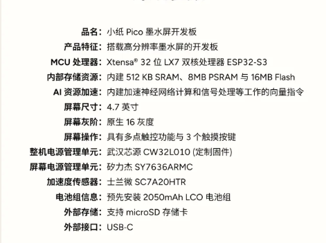

# PicoNano 硬件规格与资源约束

更新：2026-10-14。板级规格来自用户 2026-10-13 提供的资料、复用 BSP、当前设备识别结果和本仓库配置。软件品牌统一为 PicoNano；原资料与组件保留硬件/许可证身份。

2026-10-18后续EPUB源码批次增加私有publication job、ZIP finish接续任务及跨轮诊断标量；这些状态计入原应用池/调用栈，不新增画布或扩大6MiB额度。下文历史结构大小不代表本批S3对象大小；0.9.16固件源`ba71c8d`已完成板级/CI/诊断SDK6.1构建与镜像核验；产品应用5436192B、槽余855264B（13.59%），诊断5451104B、槽余840352B（13.36%）；板级引导/分区与0.9.0保持一致。编译器逐函数栈记录中开书job step为112B；这是单函数栈帧而非任务累计水位，设备另测内部堆/栈水位、读卡/输入长尾和欠载。8ms后台软预算不约束单次文件系统/章节解析调用。

开发树的首页EPUB摘要每步只借一次原32KiB内部DMA工作区，余量不足沿原4KiB退路；调用结束即释放，不跨输入轮占用大块。SDK摘要上下文随私有打开任务驻留，池内计费的自有状态与SDK池外分配须分别观察；普通PC软件任务另保留32KiB池内缓冲。独立S3对象显示单槽静态1152→1160B、async_port2352B不变，另有4B摘要端口指针；未增加画布或扩大6MiB池。分步减少输入间连续工作及取消后重复摘要，不等同单次SD调用有实时上限，也不是实卡吞吐/功耗或完整固件内存证据。

ZIP目录可暂停任务另计入原池，独立SDK对象sizeof由2216增至2224B；EPUB打开任务1488B、阅读app38632B及S3静态单槽1160B/async_port2352B保持。目录尾部最多65557B、可选中央快照最多128KiB沿原上限，准备成功转交原archive而非复制。分步状态跨输入轮驻留，不能只看之后的旅程峰值而称零内存成本；没有新增像素帧或扩大池，也没有完整固件堆/栈实测。

## 固定设备规格

前台EPUB调度新增S3静态任务wrapper4B，原hot_session1160B/async_port2352B保持；私有打开/ZIP/hash继续计原池，无新画布或TF并发。64位主机library25120→25136B，等待中的选择快照另为1840B及分配头，这些主机大小不能当S3结构大小。目录/摘要逐轮后仍有文件系统及元信息/字体/布局最长同步调用，1ms让出/每50轮10ms是调度策略而非响应上限；连续输入与真实功耗需对应固件测量。

| 项目 | 规格 | 依据及边界 |
| --- | --- | --- |
| 板型/屏幕型号 | RDP-G01-W / E0470A01 | 已有 BSP 的适配目标 |
| MCU | ESP32-S3，Xtensa LX7 双核；当前设备 rev0.2 | CPU 当前配置 240MHz |
| 内部 SRAM | 512KiB 总量 | 包含 SDK、静态区、任务栈和堆，不能另设 512KiB 应用堆 |
| PSRAM | 8MiB | 应用池最多 6MiB，还需按初始化后可用量缩减 |
| Flash | 16MiB；当前器件 Zbit `5E:4018` | 120MHz 板级配置针对已核对器件，不能推广到其他 Flash |
| 面板 | 4.7 英寸，684×1216 逻辑竖屏，原生 16 灰阶 | 4bpp 单帧 415872 字节；按对角线推算约 297ppi，非有效尺寸实测 |
| 输入 | CST836U 触控、3 个触摸按键 | 实际坐标/阈值/手感需设备验证，不承诺未测采样率 |
| 整机 PMU | CW32L010，定制固件 | 管理整机状态、时钟与电源；不等同独立永久 RTC |
| 屏幕 PMU | SY7636ARMC | VCOM 与电源时序受硬件约束 |
| 加速度传感器 | SC7A20HTR | 器件存在不表示拿起唤醒或自动旋转已交付 |
| 电池 | 2050mAh LCO 电池组 | 没有最新阅读/待机实测，不能据容量推算续航 |
| 外部存储 | microSD/TF | 当前 BSP 使用 1 位 SDMMC 高速模式；不假定支持拓宽接线 |
| 接口 | USB-C | USB 数据、供电和充电应分别验证；MSC源码已接入，真实读写/退出待验收 |
| 其他能力 | 芯片有向量扩展 | 自有混合路径尚未加入专用 SIMD；不据此声称 AI 能力 |
| 无线 | 2.4GHz WiFi 802.11 b/g/n、BLE 5.0（芯片能力） | 已用 WiFi AP/STA 传书与对时；BLE 未使用；无 5GHz、无经典蓝牙音频 |
| 芯片其他资源 | 384KiB ROM、16KiB RTC SRAM、ULP 协处理器、GDMA、USB OTG/Serial-JTAG | 来自乐鑫芯片资料；RTC SRAM/ULP 当前未使用 |
| 蜂鸣器 | GPIO2，PWM 驱动 | 复用 BSP 有驱动，产品未使用；不是扬声器 |
| 额定输入 | 5V ⎓ 1.8A（厂商标称） | 实际充电电流/电压未测 |
| microSD 标称 | 最高 512GB，FAT32（厂商标称） | 实际兼容卡型以设备测试为准 |
| 外形 | 117.5×66.2×7.3mm，91±2g；AGC 蚀刻防眩玻璃盖板 | 厂商标称，非本项目测量 |

无前光和扬声器的产品硬件依据，不增加虚假的亮度或朗读控制。

## 板级连线与外设（BSP 源码核对）

下表与用户 2026-10-14 提供的厂商资料整理一致，并已逐项对照复用 BSP（`components/read_pico`、`cst836u`、`fca9555`、`sc7a20h`、`sy7636a`、`read_pico_pmu`）源码中的宏和 Kconfig 默认值。它是板内连线，不代表外壳引出可用 GPIO；GPIO45/46 等有启动/输入限制，不能随意改作他用。

| 功能 | ESP32-S3 引脚 / 地址 | 当前使用 |
| --- | --- | --- |
| I²C SDA / SCL | GPIO39 / GPIO40，400kHz | 所有 I²C 外设共用 |
| EPD D0–D14 / D15 | GPIO4–GPIO18 / GPIO45 | LCD 外设 + GDMA 16 位并口 |
| EPD XLE / XSTL / XCL / SPV / CKV | GPIO3 / 46 / 21 / 47 / 48 | 同上；像素时钟默认 18MHz，范围 12–24MHz，欠载退回安全值 |
| CST836U 触控（2 点） | I²C 0x15，INT GPIO43，复位 FCA9555 P0.7 | 空闲时等 INT 任意边沿唤醒（50ms 兜底），触摸中 10ms 轮询 |
| FCA9555 GPIO 扩展 | I²C 0x24，INT GPIO41 | 浅睡唤醒用 INT；P0 位见下 |
| SC7A20H 三轴加速度计 | I²C 0x19，INT1 GPIO1 | 未使用（无拿起唤醒/自动旋转） |
| SY7636A 屏幕电源 | I²C 0x62 | 只经 BSP 时序上电/读 VCOM 路径，不写标定/时序寄存器 |
| CW32L010 整机 PMU（定制固件） | I²C 0x2A，中断经 FCA9555 P0.2 | VCOM 读取、按键、运行握手、时间同步 |
| microSD CLK / CMD / D0 | GPIO38 / GPIO42 / GPIO44 | 1 位 SDMMC 高速（40MHz） |
| 蜂鸣器 | GPIO2 | 未使用 |

FCA9555 P0：P0.0 MODE、P0.1 XOE、P0.2 CW_INT（输入）、P0.3 SY_EN、P0.4 SY_VCOM_EN、P0.5 SY_PGOOD（输入）、P0.6 SD_CD（输入，插卡检测）、P0.7 TP_RST。

芯片级参数（如 SY7636A 的 ±15V/+29V/−25V 输出能力、CW32L010 的 Cortex-M0+ 48MHz、SC7A20H 的 ±2–16g/12 位/32 级 FIFO）只描述器件能力，不代表本板实际电源轨、PMU 子型号或已交付功能。尚未确认：模组/Flash/PSRAM 料号、充电 IC、电池保护、USB-C CC/数据电路、整机深睡与 WiFi 电流、面板各模式实测刷新时间。

开发树的整书SHA池入口直接借原内部DMA工作区，省去硬件未使用的32KiB池内PSRAM临时块；内部32KiB/4KiB准入、总池上限和完整校验保持，新增S3静态能力指针4B。SDK6.1独立对象确认核心池入口单函数栈144B、端口自管入口64B，原4KiB退路仍在，不代表32KiB产品任务累计水位；主机PSA替身保存全输入的堆不能当作设备SHA内存行为。完整固件链接、实卡吞吐与设备堆峰仍待本批构建和真机验证。

## 硬件能力使用核查（2026-10-14）

| 能力 | 状态 | 依据 / 剩余空间 |
| --- | --- | --- |
| 双核 240MHz | 已用 | 产品 owner 核 1，输入/显示核 0；0.6.5 起翻页扫描约 470ms 期间核 1 为下一页排版/预热字形（欠载即停用） |
| Octal PSRAM / Flash 120MHz、64KiB 数据 cache | 已用 | 指令 cache 仍为默认 16KiB，32KiB 是否值得占内部 SRAM 需 A/B 实测 |
| LCD + GDMA 16 位并口 | 已用 | GL16/GC16 产品路径；DU/快速 8 灰阶未通过本面板技术门，未开放 |
| 硬件 SHA | 已用 | 整书摘要；读取块已由 4KiB 改为可用时 32KiB 内部 DMA 块 |
| SDMMC | 已用到 1 位 40MHz 上限 | S3 不能 DMA 到 PSRAM，IDF 按 16 扇区中转；4 位总线受板级接线限制 |
| 电源管理（DFS / 自动浅睡） | 0.6.3 首次真正启用，待实测 | 0.6.1/0.6.2 因漏含 sdkconfig.h 实际未启用（真机日志无 DFS 行），工作区已修复。DFS 工作 240MHz、空闲约 1 秒后 80MHz；浅睡时 IDF 隔离全部 GPIO，SD/I²C/中断加睡眠上拉、蜂鸣器下拉；tickless 自动浅睡在无锁时进入，空闲触摸 30ms 定时采样，插电脑 USB 时不睡。实际电流、唤醒延迟和触摸漏检需真机测 |
| 触控 / 扩展器中断 | 部分（0.6.2） | GPIO43 触摸 INT 用于空闲唤醒输入任务（失效退回轮询，INT 实际波形未实测）；GPIO41 仅用于浅睡唤醒；卡检测 250ms 轮询 |
| 向量指令（PIE） | 未用 | 帧转换、差分比较、字形混合为标量循环；先测占比 |
| 加速度计 / BLE / 蜂鸣器 / ULP / RTC SRAM | 未用 | 均需独立产品与功耗门，不预先声称 |

## 板级配置与已使用的加速通路

[sdkconfig.defaults](../sdkconfig.defaults) 是板级配置，[sdkconfig.ci](../sdkconfig.ci) 用于独立编译验证：当前板级 Flash/PSRAM 120MHz、64KiB 数据 cache、64B cache line、性能编译、1ms FreeRTOS tick、USB 控制台；CI 使用独立保守配置，不能相互覆盖。特定 Zbit 的温漂/时序兼容设置保持当前核对值，不自行修改标定、厂表或提频。

CPU 已按 240MHz 使用，产品 owner 在核 1，输入/显示在核 0；LCD/GDMA 条带输出与经过启动自检的 SDK SHA 端口已接入。S3 的 SDMMC 不能直接 DMA 到 PSRAM，IDF 会按 16 扇区临时中转；整书摘要在内部余量足够时临时借 32KiB 内部 DMA 块，否则用内部对齐 4KiB 工作区，避免将 PSRAM 大缓冲误当成直接 DMA。配置启用不代表吞吐已达到上限，详见[架构的资源评估](ARCHITECTURE.md#性能利用与阅读优化)。

`CONFIG_ESP_PHY_ENABLE_USB` 在无线互斥适配中关闭；无线活动期暂停 USB 数据 PHY，退出并完成清理后恢复，供电/充电继续。插线射频影响的真实根因尚未确认，不能把这项候选修复视为硬件问题已经解决。

## 内存和并发上限

共享常量见 [pn_hardware.h](../components/pn_core/include/pn_hardware.h)，分类账本及可回收缓存见 [pn_alloc.h](../components/pn_core/include/pn_alloc.h)。

| 资源 | 当前约束 |
| --- | --- |
| 应用池 | 上限 6MiB；驱动初始化后按实际 PSRAM 空闲量减 256KiB 再收缩 |
| 可重建缓存 | 池≥6MiB 时共享总额 2MiB，4–6MiB 为 1.5MiB，小池 1MiB（[pn_alloc.c](../components/pn_core/pn_alloc.c)），属于应用池内部；分项上限不可以同时相加使用。字形位图 1024 槽/704KiB，约容两页 44px 中文；菜单整页帧两槽约832KiB（≥6MiB池），压力下最先回收 |
| 分项准入 | 邻页 512KiB、字形 768KiB、非活动封面 384KiB、章节语义 384KiB；字体自身上限另行约束 |
| 前台余量 | 池的 1/8，最多 256KiB；可选预排/预热不驱逐前台资源、不触发全局回收 |
| 传输任务栈 | 文件worker 32KiB使用PSRAM及SDK配对创建/删除；监督任务16KiB、HTTP16KiB仍为内部栈，独立于应用池；实际水位与无线余量待真机 |
| 产品任务栈 | 32KiB；阅读组件拒绝单函数栈帧大于 16KiB并输出 `.su`，仍需累计调用水位实测 |
| 首屏提前排版 | 沿用单槽与原节点/语义缓存，无新增像素帧；节点提前驻留计原池。独立S3对象的准备函数栈TXT144B、EPUB2240B，不能当整条调用链或任务水位 |
| 首屏正文分片 | 借原帧每步最多8节点，字形仍计原缓存；S3 TXT/EPUB app新增56/48B，正文step单函数栈240/2336B。步骤临时保留至少2MiB池余量，不以单函数栈代表32KiB任务累计水位 |
| 开书分阶段交接 | 单槽新增原池指针和排版待续位，S3静态1144→1152B；源就绪与首屏布局跨输入轮分开，无新增帧或池额度。完整SHA/构造与单次布局仍同步，真实堆/栈和端到端时延另验 |
| 输入/显示任务栈 | 分别 4KiB / 8KiB；核 0，优先级分别 6 / 5 |
| 显示缓冲 | 4bpp 产品帧（池内）与 epdiy 前/后/差分缓冲（池外约 1.66MB）分别记账；已显示参考直接用 epdiy 后缓冲，不再在池内另存 406KiB 逻辑副本 |
| 文件port与stdio | FILE/VFS对象及其内部缓冲不在应用pool账本；未绑定池缓存的文件源还可能持有一个4KiB libc读块，关闭时释放。字体/EPUB源已绑定池内缓存；单槽提前开书会提前持有文件资源，池峰不能代表设备总内存，须同时采集内部/PSRAM堆水位 |
| 工具栏快照 | 当前区域快照 112176 字节；其恢复用正文备份独立计入，不由快照大小代表全部显示成本 |
| 持久页边界 | 每书最多 512 项，内部缓存目录全局 128KiB；不是常驻全书分页表 |

epdiy、WiFi、文件系统、DMA、内部任务栈及其他 SDK 分配必须与池账本一起测量。分类峰值不能相加当成同时峰值，6MiB 池也不等于整机 PSRAM 占用。目标余量及验收方法见[开发指南](DEVELOPMENT_PLAN.md)。

## 仓库分区与现有设备升级边界

下表来自 [partitions.csv](../partitions.csv)，是仓库布局，**不代表现有设备的旧分区表**。

| 分区 | 偏移 | 大小 | 用途 |
| --- | --- | --- | --- |
| nvs | `0x9000` | `0x6000` / 24KiB | SDK 所需 NVS；非阅读记录存储 |
| otadata | `0xF000` | `0x2000` / 8KiB | OTA 数据；存在分区不表示设备 OTA 已实现 |
| phy_init | `0x11000` | `0x1000` / 4KiB | PHY 数据 |
| ota_0 | `0x20000` | `0x600000` / 6MiB | 应用槽 0 |
| ota_1 | `0x620000` | `0x600000` / 6MiB | 应用槽 1 |
| data | `0xC20000` | `0x100000` / 1MiB | LittleFS 记录、设置及可重建索引 |
| assets | `0xD20000` | `0x1E0000` | 预留资源分区 |
| wallpaper | `0xF00000` | `0x100000` / 1MiB | 已应用锁屏 A/B 位图及元数据 |

已核对旧设备 NVS 范围与仓库不同，默认网页升级严格比较其已知旧表，仅写 `0x20000` 应用。禁止用仓库完整 `flash_args` 替代保留布局升级；具体操作见[安装文档](INSTALLATION.md)。

## 不可绕过的硬件规则

VCOM 只从 PMU 读取；无有效 VCOM 不推屏，不复制到 NVS，不写 SY7636A 标定或电源时序寄存器。不手改复用波形、stb 和生成 fallback 表。启动/挂载/恢复不格式化，不静默擦除 NVS。TF 必须由一个所有者访问，未来 USB 同样受独占交接约束。

PC 使用相同预算和源码，不能提高到 6MiB 以上掩盖设备故障。主机不能仿真面板光学残影、供电、RF 干扰、总线争用、TF 延迟和续航；真实面板/无线/功耗结论必须来自设备。
